# 具身智能学习笔记（Embodied AI · VLA）

> 一个**从零开始**的具身智能（Embodied Intelligence）学习仓库。
> 写给「会一点 Python、没碰过机器人」的人：从"什么是位姿"讲到"跑通一个 VLA 模型"。
> 每条结论都尽量讲清直觉、给出可动手验证的例子，并标注哪些地方你需要回头查原文。

---

## 这是什么

**是**：一份循序渐进的知识库 + 学习路线 + 练手项目清单 + 论文阅读笔记模板。
**不是**：论文翻译合集、也不是"三天速成"教程。具身智能是个交叉很硬的领域，这里帮你把**顺序**和**主线**理清楚，减少在浩如烟海的资料里迷路的时间。

内容主线是「**感知 → 决策 → 行动**」这个闭环：机器人如何知道自己和环境的状态，如何决定做什么，如何把决定变成电机上的力矩。

> **名字里为什么有 VLA？**
> VLA（Vision-Language-Action，视觉-语言-动作模型）是当前具身智能最热的主线之一：让模型直接"看图 + 听人话 → 输出动作"。
> 但它只是**冰山一角**，底下必须有机器人学、控制、学习算法托着。本仓库按"地基 → 主干 → 前沿"来组织，VLA 放在 [docs/06](./docs/06-VLA视觉语言动作模型.md)。

---

## 我不知道从哪开始：三条最短路径

### 路径 1：只想先建立整体认知（约 3 小时）

1. [docs/00-什么是具身智能](./docs/00-什么是具身智能.md) —— 建立全景图，知道有哪些子领域
2. [docs/10-术语表](./docs/10-术语表.md) —— 把常听到的黑话扫一遍，不用背
3. [docs/09-学习路线与实践项目](./docs/09-学习路线与实践项目.md) —— 挑一条属于自己的路线

### 路径 2：想动手跑通第一个程序（约 1 个周末）

1. [docs/01-机器人学数学基础](./docs/01-机器人学数学基础.md) 的「动手练习」—— 用 numpy 写 2 连杆正逆运动学
2. [docs/07-仿真环境与工具链](./docs/07-仿真环境与工具链.md) —— 按「最短路径清单」装好 MuJoCo，让一个机械臂动起来
3. [projects/](./projects/README.md) 里挑一个 ⭐ 难度项目做完

### 路径 3：想做 VLA / 具身大模型方向（约 1~2 个月，有 ML 基础）

1. [docs/01](./docs/01-机器人学数学基础.md)（位姿与坐标变换，必读）→ [docs/03](./docs/03-运动规划与控制.md)（动作空间怎么定义）
2. [docs/05-模仿学习与示教](./docs/05-模仿学习与示教.md) —— 现代 VLA 基本都是模仿学习路线
3. [docs/06-VLA 视觉语言动作模型](./docs/06-VLA视觉语言动作模型.md) —— 主线地图 + 论文清单
4. [papers/](./papers/README.md) 按「入门必读」顺序读，用模板记笔记
5. [projects/](./projects/README.md) 里做「VLA 推理」那个项目

---

## 全景地图

```mermaid
graph TD
    A[具身智能<br/>Embodied AI] --> B[本体与硬件<br/>Body / Hardware]
    A --> C[感知<br/>Perception]
    A --> D[决策与规划<br/>Decision & Planning]
    A --> E[控制<br/>Control]
    A --> F[学习<br/>Learning]
    A --> G[数据与基础设施<br/>Data & Infra]

    B --> B1[机械臂 / 夹爪]
    B --> B2[移动底盘 / 四足 / 人形]
    B --> B3[灵巧手 / 触觉]

    C --> C1[视觉: 相机 / 深度 / 点云]
    C --> C2[本体感知: 编码器 / IMU / 力觉]
    C --> C3[标定 / 状态估计 / SLAM]

    D --> D1[任务规划 Task Planning]
    D --> D2[运动规划 Motion Planning]
    D --> D3[抓取与操作 Grasp & Manipulation]

    E --> E1[PID / 阻抗 / 力控]
    E --> E2[MPC / 最优控制]
    E --> E3[柔顺与安全]

    F --> F1[强化学习 RL]
    F --> F2[模仿学习 IL]
    F --> F3[世界模型 World Model]
    F --> F4[VLA / 具身基础模型]

    G --> G1[仿真引擎 MuJoCo/Isaac]
    G --> G2[数据集 Open X-Embodiment/DROID]
    G --> G3[工具链 ROS2/LeRobot]
```



一句话读法：**蓝色硬件是身体，感知是眼睛，规划是脑子，控制是肌肉，学习是训练肌肉和脑子的方法，数据与仿真让你不必每次都烧钱上真机。**（本图用文字描述，颜色以站点渲染为准）

---

## 内容导航

### 正文（按建议阅读顺序）

| # | 文档 | 一句话内容 | 难度 |
|---|------|-----------|------|
| 00 | [什么是具身智能](./docs/00-什么是具身智能.md) | 定义、莫拉维克悖论、发展脉络、端到端 vs 模块化 | ⭐ |
| 01 | [机器人学数学基础](./docs/01-机器人学数学基础.md) | 位姿、旋转矩阵/四元数、SE(3)、DH、正逆运动学、雅可比 | ⭐⭐⭐ |
| 02 | [感知与传感器](./docs/02-感知与传感器.md) | 相机模型、标定、点云、6D 位姿、SLAM 入门 | ⭐⭐ |
| 03 | [运动规划与控制](./docs/03-运动规划与控制.md) | PID、阻抗控制、MPC、RRT、轨迹生成 | ⭐⭐⭐ |
| 04 | [强化学习与机器人](./docs/04-强化学习与机器人.md) | MDP、PPO/SAC、奖励设计、sim2real | ⭐⭐⭐ |
| 05 | [模仿学习与示教](./docs/05-模仿学习与示教.md) | BC、分布偏移、DAgger、动作分块、扩散策略 | ⭐⭐⭐ |
| 06 | [VLA 视觉语言动作模型](./docs/06-VLA视觉语言动作模型.md) | RT-1/RT-2/OpenVLA/Octo/π0、动作表示、评测 | ⭐⭐⭐ |
| 07 | [仿真环境与工具链](./docs/07-仿真环境与工具链.md) | MuJoCo/Isaac/PyBullet 对比、URDF、ROS2、环境搭建 | ⭐⭐ |
| 08 | [硬件平台面面观](./docs/08-硬件平台面面观.md) | 机械臂/四足/人形、夹爪 vs 灵巧手、指标怎么读、选型 | ⭐ |
| 09 | [学习路线与实践项目](./docs/09-学习路线与实践项目.md) | 三条路线、12 周计划、分级项目清单 | ⭐ |
| 10 | [术语表](./docs/10-术语表.md) | 90+ 中英对照术语，按主题分组 | ⭐ |

> 不想按顺序读：[docs/README.md](./docs/README.md) 有一份按"问题"组织的索引（我想搞懂 XX 该看哪篇）。

### 配套

| 目录 | 用途 |
|------|------|
| [plan/](./plan/2026-11-23-路线A-12周计划.md) | 我的学习计划与排期（12 周表 + 每周验收标准） |
| [papers/](./papers/README.md) | 论文三遍读法、分级论文清单、[论文笔记模板](./papers/论文笔记模板.md) |
| [projects/](./projects/README.md) | 15+ 个 ⭐~⭐⭐⭐⭐⭐ 练手项目，含验收标准 |
| [resources/](./resources/资源清单.md) | 教材、公开课、官方文档、数据集、社区 |
| [notes/](./notes/README.md) | 我的学习笔记与每周复盘（[模板](./notes/学习笔记模板.md)） |

---

## 学习节奏的一点建议

具身智能最容易死掉的方式不是难，而是**卡在环境配置和"教程地狱"里**：看了一堆视频，一个能跑的东西都没有。所以：

- **以项目为锚**：每学一个概念，问"这个在我的小项目里对应哪一行代码"。项目清单见 [projects/](./projects/README.md)。
- **先仿真后真机**：仿真里 1 小时能干完的事，真机上可能要 1 天。
- **每周必须有可运行产物**：哪怕只是让机械臂到达一个点。
- **学过的概念当天用自己的话写进 [notes/](./notes/README.md)**，写不出来就是没学会。
- **范数心态**：不必读完所有前置知识。位姿和坐标变换是硬前置（一定要过一遍 [docs/01](./docs/01-机器人学数学基础.md)），其余都可以边做边补。

---

## 仓库约定

### 文件命名

```
docs/NN-中文标题.md        正文，NN 为阅读顺序
papers/YYYY-短标题.md      论文笔记（从模板复制）
notes/YYYY-MM-DD-主题.md   学习笔记（从模板复制）
projects/NN-项目短名/      每个项目一个目录，含 README.md + 代码 + 结果.md
assets/images/             截图与示意图
```

### 提交信息格式

```
<类型>(<范围>): <做了什么>

类型: docs 正文 / note 学习笔记 / paper 论文笔记 / project 项目 / chore 维护
例:   docs(01-math): 补充齐次变换左乘右乘的例子
      note(daily): 2026-11-23 跑通 MuJoCo 第一个场景
```

### 硬性纪律

- **不提交**数据集、模型权重、视频、虚拟环境（见 [.gitignore](./.gitignore)）。大数据用外链或 Git LFS。
- **不提交**含密钥的本机配置。
- 引用论文/代码时给出处；写笔记时允许写"我不懂"，但不许把猜测写成结论。
- 数学公式用 LaTeX（`$...$` / `$$...$$`），代码块标语言。

---

## 我的进度

<!-- 学完一节就把 [ ] 改成 [x]，这就是最好的进度可视化 -->

**阶段 0 · 环境**
- [ ] 装好 Python 环境（conda/uv）并跑通 PyTorch
- [ ] 装好 MuJoCo 并渲染出一个场景

**阶段 1 · 地基**
- [ ] [00 什么是具身智能](./docs/00-什么是具身智能.md)
- [ ] [01 机器人学数学基础](./docs/01-机器人学数学基础.md)
- [ ] [02 感知与传感器](./docs/02-感知与传感器.md)
- [ ] [03 运动规划与控制](./docs/03-运动规划与控制.md)

**阶段 2 · 让机器人学会做事**
- [ ] [04 强化学习与机器人](./docs/04-强化学习与机器人.md)
- [ ] [05 模仿学习与示教](./docs/05-模仿学习与示教.md)
- [ ] 完成第 1 个 ⭐ 项目

**阶段 3 · 前沿**
- [ ] [06 VLA 视觉语言动作模型](./docs/06-VLA视觉语言动作模型.md)
- [ ] [07 仿真环境与工具链](./docs/07-仿真环境与工具链.md)
- [ ] [08 硬件平台面面观](./docs/08-硬件平台面面观.md)
- [ ] 读完 5 篇必读论文并写笔记

---

## 说明

- 本仓库是个人学习笔记，内容会持续修订。发现错误欢迎改。
- 所有引用的论文、开源库、课程版权归原作者；这里只做导读与索引，不放他人的原文内容。
- 具体产品的参数、价格、榜单成绩变化很快，笔记里只保留"怎么读指标"的方法，**具体数字请以官方文档为准**。
