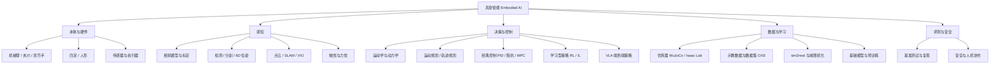

# 什么是具身智能

> 一句话导读：这篇文档回答"具身智能（Embodied Intelligence）到底是什么、它和聊天机器人有什么本质不同"，并给出一张全景地图，让你知道后面十几篇文档分别补的是哪块砖。

## 学习目标

- [ ] 能用自己的话说出具身智能的定义，并指出它与大语言模型（Large Language Model, LLM）这类纯软件 AI 的关键差别。
- [ ] 能解释莫拉维克悖论（Moravec's Paradox），并说明为什么"下棋对机器容易、走路对机器难"。
- [ ] 能按阶段讲出这个领域的发展脉络，并说清每个阶段"卡在哪里"、下一阶段解决了什么。
- [ ] 能说清本体与硬件、感知、决策与控制、数据与学习这四大支柱各自干什么、难在哪。
- [ ] 能对比端到端（end-to-end）与模块化（modular）两条路线，说出各自优点和风险，不迷信任何一方。

## 正文

### 1. 直觉先行：会答题，不等于会做事

想象两个人同时考驾照。甲把交规背得滚瓜烂熟，能默写每条法规；乙没怎么背书，但天天在路上开。谁更容易把车开进一个很窄的车位？答案显然不是甲。大语言模型就像甲：它在海量文本上训练，能解释"倒车入库要打死方向盘回正"，但它没有手、没有眼睛、没有身体，说了也不等于做到了。而机器人要完成"把杯子放进洗碗机"这种对人类毫不费力的动作，需要的不是更多文字，而是**在真实物理世界里反复试、反复看、反复改**。

这就是"具身"（embodied）两个字的重量：**智能不是飘在空中的计算，它长在一个会动、会碰、会疼的身体上**。

### 2. 定义：智能 + 身体 + 闭环

具身智能（Embodied Intelligence，也常写作 Embodied AI）通常指：

> 一个智能体（agent）拥有物理身体（真机，或至少是遵守物理规律的仿真身体），通过传感器（sensor）感知环境、通过执行器（actuator）改变环境，并在"感知—决策—行动"的闭环中学习并完成任务。

这句话里有三个不能省的词：

- **身体（embodiment）**：形态本身就在参与智能。人有两条腿、两只手，机器人可能是轮子、四足、七自由度机械臂或灵巧手——身体不同，能学会的本事也不同。
- **交互（interaction）**：知识来自"动手"，不来自"阅读"。
- **学习（learning）**：不是人手写死每条规则，而是从数据或试错中得到一个能应付新情况的策略。

生活化类比：大语言模型是**只会看菜谱的厨师**，具身智能是**站在灶台前的厨师**——火候、手感、锅有多重、油会不会溅，只有手上有锅的人才知道。

### 3. 核心结构：感知—决策—行动闭环

机器人干活不是一个"想好了再做"的一次性过程，而是每秒重复很多次的小循环：

1. **感知（perception）**：相机/深度相机/力传感器拿到观测 $o_t$；
2. **决策（decision）**：策略（policy）$\pi$ 根据观测输出动作 $a_t$；
3. **行动（action）**：电机执行动作，世界状态发生变化；
4. **回到 1**：拿到新的观测 $o_{t+1}$，继续修正。

形式化地写出来就是这样一串（看不懂符号没关系，读文字意思即可）：

$$
a_t \sim \pi(\cdot \mid o_t), \qquad s_{t+1} \sim \mathcal{T}(\cdot \mid s_t, a_t), \qquad o_{t+1} \sim \mathcal{O}(\cdot \mid s_{t+1})
$$

其中 $s_t$ 是环境的真实状态（你往往看不到），$o_t$ 是传感器观测（你能看到的、带噪声的一小部分），$\mathcal{T}$ 是物理规律决定的**状态转移**，$\mathcal{O}$ 是**观测过程**（含遮挡、噪声、延迟）。

类比：骑自行车时，眼睛看路（感知）→ 身体判断要往哪边压（决策）→ 手臂拧车把、腰腹转移重心（行动）→ 下一秒再看路。没有人是"先算好全程 500 米的车把角度"再上车的。

**闭环为什么重要**：开环（open-loop，只执行预定计划）时，任何小误差都会累积成灾；闭环（closed-loop，边做边看边改）时，误差被不断纠正。机械臂"闭着眼"伸手去抓杯子，桌面上差 1 厘米就抓空；睁开眼（有视觉反馈）就能自己纠正。

### 4. 和纯软件 AI 的四点关键差别

| 对比维度 | 纯软件 AI（如 LLM、图像分类） | 具身智能 |
| --- | --- | --- |
| 物理约束 | 几乎没有，输出文字/标签即可 | 有碰撞、关节限位、力矩上限、摩擦，不能"穿模" |
| 实时性 | 秒级响应可接受 | 控制回路常在几十到几百赫兹量级，慢一拍就可能摔（具体频率因平台而异） |
| 可观测性 | 输入基本完整 | 部分可观测：遮挡、反光、传感器噪声、通信延迟 |
| 后果 | 答案错了可以重答 | 打碎杯子、撞到人，动作**不可逆**，试错成本极高 |

由此还引出一个工程现实：**数据贵**。文字语料在网上是免费的海量资源，而真机示教数据要靠人一遍遍操作采集，一次几秒到几十秒，还需要多相机、时间同步、标注。这直接决定了这个领域为什么如此看重仿真（simulation）与开源数据集。

### 5. 莫拉维克悖论：难和易是反的

莫拉维克悖论（Moravec's Paradox）说的是：**对人类越"不费力"的事（看、走、抓、听），机器越难；对人类越"费脑子"的事（下棋、推定理、算积分），机器反而越容易。**

汉斯·莫拉维克（Hans Moravec）在 1988 年的《Mind Children》里提出这个观察，后来被广泛引用。

为什么是反的？可以从三个角度理解：

1. **规则是否已知**。下棋的规则完全写死、状态离散、可以无成本地自我对弈几百万局；而"走路"的物理模型（接触、摩擦、柔性、延迟）根本写不准，也无法便宜地仿真到以假乱真。
2. **问题的数学性质**。棋类是有限状态上的搜索；行走与抓取是**高维连续控制**问题，接触力不光滑、不可微，还带欠驱动（underactuated，控制量比自由度少）和随机性。
3. **进化的"压缩"**。人类几亿年进化把视觉与运动控制"烧"进了不占意识资源的脑区，所以你觉得走路简单——那是**几亿年训练的成果被隐藏了**；而下棋只练了几千年，反而显得"需要智力"。

用一句话反直觉地总结：**对人类难 = 符号推理，机器擅长；对人类易 = 感知运动，机器最缺。**

这也解释了领域重心的迁移：棋类在 2010 年代中期被深度强化学习攻克后，真正的难题回到"让机器人稳稳地走路和抓东西"，而这两件事至今仍需要大量数据与工程。

### 6. 发展脉络：五个阶段

不必背年份，记住"每个阶段卡在哪、下一阶段怎么破"就够。

#### 阶段一：行为主义机器人学（1980s—1990s）

罗德尼·布鲁克斯（Rodney Brooks）提出**包容式架构（subsumption architecture）**：不要先建一个完整的世界模型再规划，而是把"避障""漫游""充电"等简单反应式行为分层叠加，下层优先、上层抑制。他的名言大意是"世界就是它自己最好的模型"。

- 成果：证明了不需要精确地图也能在真实房间里行动；这条思路的著名商品化产物是 iRobot 的扫地机器人 Roomba。
- 卡在哪：行为要人手设计，做不了"把红色杯子放进上层抽屉"这种需要抽象与组合的任务——它**不学习**。

#### 阶段二：传统模块化流水线（1990s—2010s）

把系统拆成**感知 → 定位建图（SLAM）→ 任务/运动规划 → 底层控制**的流水线，每个模块用成熟经典算法。工业机械臂、AGV、仓储机器人靠这条路线大规模落地。

- 卡在哪：模块间的误差会互相传播（感知偏 2 厘米，规划就抓不到）；每个新场景都要专家重新调参；面对非结构化环境（家里、野外）极其脆弱。

#### 阶段三：深度学习进入机器人（2010s 中期）

神经网络开始替代手工特征：用大规模自采集的真机数据训练网络，直接从图像回归抓取动作；视觉 SLAM 也用上学习到的特征与语义。机器人第一次拥有了"看情况办事"的能力。

- 卡在哪：一个任务训一个网络，换个物体、换句指令就要重来；**没有通用性**。

#### 阶段四：大模型时代（2020s 初）

大语言模型带来常识与语言理解，视觉语言模型（Vision-Language Model, VLM）带来开放词汇识别。

- LLM 做**高层任务规划**：把"我有点冷"拆成"找毯子→走过去→盖上"。经典思路如 SayCan（用机器人真实"可供性"过滤 LLM 提出的不可行步骤）、Code as Policies（让 LLM 直接写调用机器人原语的代码）。
- 卡在哪：LLM 只会说话，最后一步"怎么动"仍要人写技能库；语言和动作之间还是断的。

#### 阶段五：VLA 与"基础模型 + 数据"范式（现在）

**视觉语言动作模型（Vision-Language-Action, VLA）**把"看图 + 读指令 + 输出动作"塞进一个模型，端到端训练。RT-2 展示了把网页视觉语言知识迁移到机器人动作的可能；随后出现 OpenVLA、Octo、π0 等开源或公开的通用策略模型，以及 Open X-Embodiment 这类跨机构真机数据集。当前的主流共识大致是：**算法差异在收敛，真正的护城河是数据规模、数据多样性与评测体系**——数据从哪来（遥操作、仿真合成、视频）、怎么跨不同机器人本体复用（cross-embodiment）、怎么证明它真的更好。

### 7. 四大技术支柱

| 支柱 | 要干什么 | 主要难点 |
| --- | --- | --- |
| 本体与硬件 | 提供能动的身体：机械臂、四足、人形、灵巧手、夹爪、电机与减速器 | 成本、可靠性、力控精度、散热与续航；形态决定能力上限 |
| 感知 | 把像素/点云/力/IMU 变成"我能用的状态"：检测、分割、位姿估计、SLAM | 遮挡与反光、标定误差、传感器延迟、仿真到现实的视觉差异（sim2real gap） |
| 决策与控制 | 把"想干什么"变成"每个关节出多大力矩"：规划、控制、策略学习 | 接触动力学难建模、实时性、安全约束、长任务的误差累积 |
| 数据与学习 | 提供学习所需的示教/试错数据与训练方法：模仿学习、强化学习、数据合成 | 真机数据贵且慢、跨本体迁移、评测不可复现、过拟合到特定场景 |

一个常见误解是"具身智能 = 训练一个大模型"。实际上四根柱子缺一根都立不住：本体不稳，感知再好也抖；没有数据，模型再好也学不会；控制不过关，规划再聪明也执行不到位。

### 8. 与传统工业机器人的本质差别

传统工业机器人最典型的用法是**示教—复现（teach-and-playback）**：工人手动把机械臂拖到若干关键点，示教器记录关节角序列，之后机器人就一遍遍重放这条轨迹。

- 前提：**环境固定**。工件每次都放在夹具的同一个位置，光照恒定，没有意外。
- 本质：一条**确定性程序** + 高重复精度。它极其可靠，但换一个零件就要重新示教。
- 类比：老式音乐盒，只能放一首灌好的曲子。

具身智能追求的是**开放环境下的泛化策略（generalizable policy）**：同一个策略面对没见过的杯子、没见过的桌面、没听过的说法，也能大致办成。

- 前提：接受不完美。成功率可能是 80% 而不是 99.99%。
- 本质：**从数据中学到的条件反射**，用一点精度换极大的灵活性。
- 类比：会即兴伴奏的乐手。

两者不是替代关系：工厂里高节拍、高精度的活儿，示教复现仍然是正解；而家庭服务、仓储拣选、野外作业这类"每次都不一样"的场景，才需要具身智能。

### 9. 端到端 vs 模块化：两条路线的取舍

**模块化（modular）**：把"感知—规划—控制"拆成几个可以分别开发、分别验证的模块，模块之间用明确定义的接口传数据。

**端到端（end-to-end）**：一个大网络直接吃传感器输入、吐电机指令，中间的"表示"由训练自己学出来，不人为切分。

| 维度 | 模块化流水线 | 端到端策略 |
| --- | --- | --- |
| 典型形态 | 检测器 + 位姿估计 + 运动规划 + PID/阻抗控制 | 一个大网络：图像 + 语言 → 动作序列 |
| 数据需求 | 少（很多模块靠几何与物理推导，不需要大量示教） | 大（要成千上万条示教或海量仿真交互） |
| 可解释性 | 强，每一步都能画图、能查 | 弱，中间表示难以解释 |
| 出错定位 | 容易，哪个模块错一眼看出 | 难，只能看输入输出猜 |
| 泛化能力 | 换物体/换场景常需重新标定或调参 | 见过足够多样数据时更强 |
| 实时性 | 各模块可控，但串联延迟可能较大 | 一次前向即可，但大模型推理可能很慢 |
| 安全与认证 | 有成熟工程规范可循 | 难保证，通常要外挂安全层 |
| 适合场景 | 环境结构化、要求高精度高可靠 | 环境开放、任务多样、可容忍一定失败率 |

**实践中的答案往往不是二选一。** 现在很多系统采用分层混合：慢的"大脑"（VLM/VLA）以较低频率输出子目标或粗动作，快的"小脑"（传统控制器、阻抗控制、安全限位）以高频率跟踪并兜底。这样既有语义泛化，又有工程可靠性。

评估一条路线好不好，别看它发了什么论文，看三个问题：**数据从哪来？失败时怎么办？换一台机器人还能不能用？**

### 10. 具身智能全景地图



文字版层次关系（自下而上）：

```
应用层    家庭服务 / 仓储拣选 / 工业装配 / 科研平台
  ↑
方法层    VLA 端到端策略 │ 模仿学习 │ 强化学习 │ 经典规划控制
  ↑
能力层    抓取 │ 行走 │ 双臂操作 │ 导航 │ 语言指令跟随
  ↑
基础层    机器人学数学（位姿/运动学/雅可比）│ 感知与标定 │ 控制理论 │ 仿真
```

读这张图的方式：**越靠下越"必须会"，越靠上越"可以选"**。零基础读者永远从基础层开始，不要一上来就想训 VLA。

### 11. 下一步该读什么

- 想补数学与运动学（位姿、雅可比、正逆运动学）：继续读 [机器人学数学基础](./01-机器人学数学基础.md)。
- 想看整体学习安排、时间投入与练手项目：读 [学习路线与实践项目](./09-学习路线与实践项目.md)。
- 遇到看不懂的名词：随时查 [术语表](./10-术语表.md)。

## 动手练习

**练习 1：亲眼看到"闭环"比"开环"强。** 下面这段代码用一个一维质点模拟"伸手够目标点"，对比开环与闭环，只用标准库，直接运行即可。你会看到：闭环稳稳停在 1.0，而开环按固定推力一直加速，最后冲到几十米开外。

```python
def run(closed_loop: bool, steps: int = 80, dt: float = 0.05):
    p = v = 0.0                                  # 真实位置、真实速度
    target, kp, kd = 1.0, 10.0, 5.0              # 目标点、比例增益、阻尼增益
    for _ in range(steps):
        u = kp * (target - p) - kd * v if closed_loop else kp * target
        v += u * dt                              # 闭环：看着当前状态纠偏；开环：只管按计划出力
        p += v * dt
    return p

for mode in (True, False):
    p = run(mode)
    print(f"{'闭环反馈' if mode else '开环计划'}: 最终位置={p:.3f}, 误差={abs(1 - p):.3f}")
```

**练习 2：加入"部分可观测"。** 把闭环分支改成只用带噪声的测量值 `p_meas = p + random.gauss(0, 0.1)`（记得 `import random`），观察末端抖动变大；再把噪声标准差调到 1.0，观察控制器发散。这就是"感知噪声会直接变成动作抖动"的最小例子。

**练习 3：一句话辨析。** 用 3 句话向朋友解释：为什么"机器人下象棋比叠衣服容易"？把答案写在 `notes/` 下自己的笔记里。

## 常见误区

1. **新手常以为"具身智能 = 给大模型加个机器人壳子"，其实是：难点在物理闭环本身。** 语言模型再强，也解决不了接触摩擦、延迟、标定误差；这些是"身体的问题"，不是"语言的问题"。
2. **新手常以为"仿真里成功就等于真机能用"，其实是：sim2real gap 才是主要工作量的来源。** 仿真缺的是真实摩擦、柔性、传感器噪声、通信延迟。用域随机化（domain randomization）能缓解一部分，但不是保险。
3. **新手常以为"端到端更先进，所以模块化过时了"，其实是：两条路线各有明确的适用场景。** 高精度、高可靠性、需认证的工业场景仍大量使用模块化方案；端到端胜在开放环境与任务多样性。
4. **新手常以为"机器人学习就是强化学习"，其实是：当前真机操作里模仿学习（尤其行为克隆 + 动作分块）用得更普遍。** 原因是 RL 在真机上试错太贵、太危险，而示教数据能直接监督学习。
5. **新手常以为"动作越精细越难，所以走路比下棋简单"，其实是：莫拉维克悖论说的正好相反。** 对人类不费力的感知运动任务，对机器才是硬骨头。

## 延伸阅读

- Hans Moravec, *Mind Children: The Future of Robot and Human Intelligence*, Harvard University Press, 1988 —— 莫拉维克悖论的原始出处。
- Rodney A. Brooks, *A Robust Layered Control System for a Mobile Robot*, IEEE Journal on Robotics and Automation, 1986 —— 包容式架构（subsumption architecture）的奠基论文。
- Sergey Levine 等，*Learning Hand-Eye Coordination for Robotic Grasping with Deep Learning and Large-Scale Data Collection*, 2016 —— "深度学习 + 大规模真机数据"路线的标志性工作。
- Michael Ahn 等，*Do As I Can, Not As I Say: Grounding Language in Robotic Affordances*（SayCan），arXiv:2204.01691 —— LLM 做机器人任务规划的经典论文。
- Brianna Zitkovich 等，*RT-2: Vision-Language-Action Models Transfer Web Knowledge to Robotic Control*, arXiv:2307.15818 —— VLA 的代表作。
- Open X-Embodiment Collaboration, *Open X-Embodiment: Robotic Learning Datasets and RT-X Models*, arXiv:2310.08864 —— 跨机构真机数据集与跨本体训练。
- Moo Jin Kim 等，*OpenVLA: An Open-Source Vision-Language-Action Model*, arXiv:2406.09246 —— 可下载、可微调的开源 VLA。
- 官方文档（版本与用法以官网为准）：[MuJoCo 文档](https://mujoco.readthedocs.io/)、[Isaac Lab 文档](https://isaac-sim.github.io/IsaacLab/)、[LeRobot 仓库](https://github.com/huggingface/lerobot)。

## 自测题

**1. 用一句话给"具身智能"下定义，必须包含"身体"和"闭环"两个要素。**

<details><summary>点击查看答案</summary>

具身智能指拥有物理身体的智能体，通过传感器感知、通过执行器行动，并在"感知—决策—行动"的闭环中学习并完成任务。（关键点：有身体、有闭环、学习而非手写规则。）

</details>

**2. 莫拉维克悖论在说什么？举一个它预测的现象。**

<details><summary>点击查看答案</summary>

它指出：对人类来说是高阶智力的事（下棋、推定理）机器相对容易，而人类觉得毫不费力的感知运动能力（走路、抓取、识别面孔）对机器极难。现象例子：国际象棋程序早已击败人类世界冠军，但让机器人稳定地在杂乱桌面上抓起一个杯子，至今仍是不小的工程挑战。

</details>

**3. 具身智能与传统工业机器人的"示教—复现"最本质的差别是什么？**

<details><summary>点击查看答案</summary>

传统示教—复现是在固定环境下重放确定性轨迹，换来高重复精度；具身智能是在开放环境下用学习得到的泛化策略应对没见过的情况，用一点精度换极大的灵活性。前者不学习、不泛化，后者能泛化但成功率不保证。

</details>

**4. 端到端策略相比模块化流水线，主要优势和主要风险各是什么？**

<details><summary>点击查看答案</summary>

优势：中间表示由数据学出来，面对多样物体与开放指令时泛化更强，且不需要为每个场景手工设计接口。风险：需要大量示教/仿真数据，可解释性和出错定位都差，安全与实时性难以保证，通常必须外挂安全层或与传统控制器分层配合。

</details>

**5. 为什么"实时性"和"不可逆后果"这两条，会直接改变这个领域的技术选择？**

<details><summary>点击查看答案</summary>

实时性逼着系统在几十到几百赫兹内完成感知到动作的闭环，秒级的大模型推理不能直接放在最内环，所以常采用"慢思考 + 快执行"的分层结构。不可逆后果意味着真机上不能随意试错，所以数据主要来自遥操作示教与仿真，同时必须限制速度、力矩并加急停与安全区域——这也是强化学习在真机上远不如在仿真里常用的原因。

</details>
