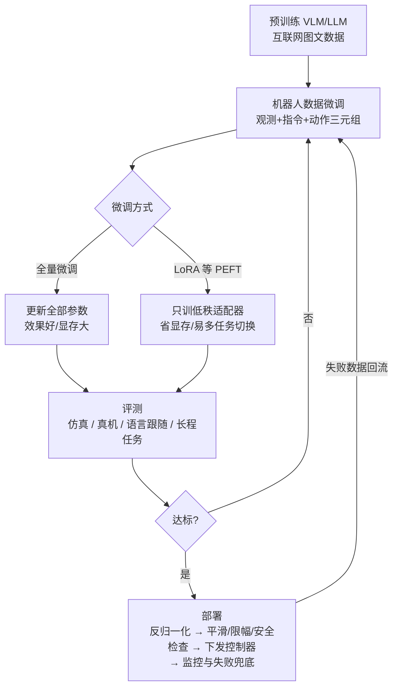

# VLA 视觉语言动作模型：从「听懂一句话」到「动对手腕」

> 一句话导读：VLA 想做的，是把「看图 + 听人话 → 直接输出电机指令」压进**一个**神经网络；理解它的关键，是理解**动作到底怎么被表示成一个可学习的目标**。

## 学习目标

- [ ] 说清传统模块化流水线在「把粉色杯子放进左边抽屉」上要写多少东西，以及 VLA 想省掉哪一段。
- [ ] 区分三种范式（LLM 出计划调技能库 / VLM 感知 + 独立控制器 / VLA 端到端），并解释为什么它们不是「升级替代」关系。
- [ ] 对比四类动作表示（离散 token 自回归、连续回归头、扩散头、流匹配头）的原理、优缺点与代表工作。
- [ ] 解释动作分块、动作归一化、动作空间选择各自解决什么问题、又引入什么新问题。
- [ ] 面对一篇 VLA 论文的结果表，能用一份清单质询「成功率 90%」到底意味着什么。

## 正文

### 1. 问题直觉：为什么「直接看图出动作」既诱人又难

**先看传统方案有多重。** 让桌面机械臂执行一句人话「把粉色杯子放进左边抽屉」，经典机器人工程要写的东西大致是：① 文本入口（ASR 已很便宜）；② 语言解析成结构化意图 `pick(target=粉色杯子, dest=左边抽屉)`，还要处理「那个」「稍微靠右」这类指代与模糊量词；③ 场景感知——相机图像 → 检测框，想支持「粉色」这种开放属性就得换开放词汇检测或视觉语言模型（Vision-Language Model, VLM）；④ 2D 框 → 3D 位置，需要相机标定、手眼标定、深度图、6D 位姿估计（6D pose estimation），杯子是圆柱、有反光、可能被遮挡，这里就开始掉成功率；⑤ 抓取规划——抓取位姿（grasp pose）、抓多深、会不会碰倒旁边的东西；⑥ 运动规划——逆运动学（inverse kinematics, IK）+ 采样式路径规划（如 RRT 一类），处理碰撞、关节限位、奇异点；⑦ 执行与闭环——发轨迹、监控到位、抓空重试、滑落重抓；⑧ 抽屉那一步再来一遍——走到抽屉前、拉把手、放入、松手，又是一套关节物体操作；⑨ 异常处理——抽屉锁着、杯子比预想重、中间被人挡一下。

这就是经典分层流水线：**语言 → 符号意图 → 感知 → 几何 → 规划 → 控制**。它极其可靠、可解释、可单测、能人工兜底，但代价有三：

- **工程量随任务组合爆炸**。每一环都是独立子系统，接口是人设计的（框坐标、位姿四元数、抓取宽度）。加新任务往往不是「加一句 prompt」，而是「加一批标注 + 改一段规则」。
- **误差串联**。检测偏 2 cm，位姿再偏 2 cm，抓取就失败；串联成功率是各环节之积，环节越多越脆。
- **语言与几何之间有语义鸿沟**。人说「粉色」，检测器输出类别 id；人说「左边」，代码里是像素坐标比较。这个翻译层人手写，永远覆盖不全。

**VLA 的期望很朴素**：能不能有一个模型，输入（相机图像，一句自然语言指令），输出直接是机械臂接下来若干步的动作？

```
观测 o_t (RGB 图像, 可能含本体感知) + 指令 ℓ ("把粉色杯子放进左边抽屉")
        ↓  VLA 策略 π
动作块 a_{t:t+k} (关节位置 / 末端位姿增量 / ...)
```

如果这能工作，上面第 ②~⑥ 步就被**同一个网络**吞掉：不再有人工设计的中间符号，不再有手写的语义→几何翻译。你只需收集「人在这个场景说了这句话、示范者这样动」的数据，然后监督学习。

诱人之处在于**泛化路径变了**：传统方案靠「加模块、加规则」，VLA 靠「预训练常识 + 更多样的机器人数据」。模型在互联网图文数据上见过「粉色」「左边的抽屉」，这种语义先验能迁移到没见过的物体与指令组合。

困难之处在于这件事在数学上比语言建模难得多：**输出空间连续且高维**（语言模型每步从几万 token 里挑一个；机械臂每步要吐 7 维连续实数且时序连贯）；**错误不可撤销**（说错一个词下句能改，把杯子碰下桌这回合就结束了）；**数据昂贵且异构**（互联网文本免费，机器人演示要人遥操作一条条录，且各本体关节数、量纲、相机位置全不同）；**存在分布漂移**（模型自己动一下世界就变了，下一帧观测落在训练分布外——行为克隆（behavior cloning）经典的复合误差（compounding error）问题）。

> 记住这个张力：**VLA 用「端到端可微」换掉「人工接口」，用「数据」换掉「规则」，但数据很贵、动作很连续、错误很致命。**

### 2. 三种范式：别把它们混成一锅

新手最容易犯的错，是把「用大模型做机器人」当成一件事。其实至少三条路线，**接口位置**完全不同。判断一个系统属于哪种，只需问：**连续动作是谁产生的？**

**范式 A：LLM 出文本计划 → 调用预定义技能库。** 把大语言模型当**高层规划器**，它不输出电机指令，只输出文本/代码去调用人写好的技能函数。**SayCan**（Google，2022）是标志性工作，核心洞察很漂亮：LLM 知道「拿苹果」语义上合理，却不知道机器人此刻**能不能**做到；于是把 LLM 对「下一步做 skill X」的语言概率与一个**可供性函数**（affordance function，通常是学出来的价值函数）给出的「当前状态能成功」的概率结合，让语义通顺且物理可行的步骤胜出，不可行的被过滤——标题「Do As I Can, Not As I Say」就是这个意思。**Code as Policies**（Google，2022 前后）更激进：让 LLM **直接写 Python 代码**，代码里调机器人原语（如 `move_to`、`grasp()`）与感知 API，还能用循环、条件、numpy 做几何计算，表达力强（「把所有积木按颜色排成一排」写成代码比列动作序列自然得多）。

优点（这是真实优势不是安慰奖）：可解释可审计（计划是文本/代码，能读能改能静态检查）、可验证（能单测、能查前置条件）、数据效率极高（不需训策略，LLM 能力随基座升级而免费升级）、安全易兜底（每个技能函数都能加速度/力限幅、工作空间限制）。缺点也是结构性的：**技能库覆盖决定系统上限**（库里只有 `pick` 和 `place_on_table`，LLM 再聪明也变不出「拉开抽屉」）；**语言与动作之间仍然是断的**（符号到连续动作那段仍由人写控制器，所以对**接触丰富**（contact-rich）的精细操作几乎无能为力——「把钥匙插进锁孔」没法靠调 `insert()` 解决）；错误恢复弱（技能失败只给一句 `failed`，难做细粒度纠正）。

**范式 B：VLM 做感知/定位 → 独立控制器执行。** 不追求一个模型干完所有事，把 VLM 用在它最擅长的**开放词汇语义理解与空间定位**上：开放词汇检测/分割模型把「粉色杯子」定位成掩码或框，VLM 判断「哪个是左边抽屉」，点云 + 位姿估计得 6D 位姿，抓取规划器与运动规划器执行。优点：每个模块都能用最强现成模型，不需联合训练，工程上最易落地；语义泛化来自 VLM（换「蓝色马克杯」「像企鹅的杯子」改 prompt 即可，不用重训）；中间结果（框、掩码、位姿）都可可视化。缺点：**接口仍是人工设计的，且往往是信息瓶颈**（一个 2D 框丢掉了「杯子斜着躺」的信息，位姿估计就可能错）；**感知对了动作不一定对**（VLM 说「杯子在这儿」，但怎么抓、抓多深、用多大力它完全不懂——它没有动作概念）；误差仍串联，只是把「语言→符号」的鸿沟换成了「语义→几何」的鸿沟。

**范式 C：VLA 端到端。** 一个模型，输入图像（+ 指令），输出动作，中间**完全没有**人设计的符号接口：视觉编码器、语言编码器、动作解码头在同一网络里，用「(观测, 指令, 动作)」三元组监督。关键区别在于**动作是网络的输出，不是另一个模块的输出**——这听起来像文字游戏，但梯度因此能从动作误差一路回传到视觉特征，模型会学出「为了抓得准我该看哪里」的面向任务表征，而非通用的「图里有什么」。优点：没有接口瓶颈；能学接触丰富的行为（输出即连续动作，细微力/位调整可被示范教会）；有统一的跨任务跨本体接口。缺点：**数据饥渴**（端到端没有先验注入点，全靠数据）；**黑箱**（失败时说不清是「没看见」还是「看见了但动作错了」）；**实时性压力大**（几十亿参数模型要以 10~50 Hz 出动作）；**安全验证困难**（网络输出直接进电机，需外挂独立限幅/急停层）。

| 维度 | A：LLM + 技能库 | B：VLM 感知 + 控制器 | C：VLA 端到端 |
|---|---|---|---|
| 输入 | 指令 + 技能库描述 + 状态摘要 | 图像+指令（VLM 侧）；点云（控制侧） | 图像（+本体状态）+ 指令 |
| 中间产物 | 文本计划 / 代码 | 框、掩码、6D 位姿、抓取位姿 | 无显式符号（隐特征黑箱） |
| 输出 | 技能调用序列 | 轨迹 / 关节指令（规划器产生） | 动作 token 或连续动作块 |
| 连续动作谁产生 | 人写的技能/控制器 | 独立规划与控制器 | 模型本身 |
| 可解释性 | 高（可读可改） | 高（中间量可视） | 低（需额外工具归因） |
| 数据需求 | 极低（几乎不需机器人数据） | 中（感知可复用，控制需标定/少量数据） | 高（大量演示 + 多样本体验证） |
| 泛化范围 | 语义强；**动作**受技能库限制 | 语义强；几何中等 | 语义与动作都可泛化，受数据覆盖限制 |
| 典型失败模式 | 库里没有的动作做不了；接触任务失败 | 感知对但抓取/规划失败；误差串联 | 分布外静默失败；抖动；语言跟随差 |
| 上手成本 | 最低 | 中（标定 + 集成） | 高（训练/微调 + 部署优化） |

**三者不是升级替代关系**（很多科普讲成 A→B→C 的进化史，这是错的）。① **工程上常混用**：真实移动操作（mobile manipulation）系统极可能是 VLM 做分解与定位（A/B 混合）→ VLA 策略负责「抓起来放进抽屉」这个短程技能（C）→ 底盘用经典 SLAM 与规划。② **VLA 内部也常分层**：很多「VLA」其实是**双系统**（dual-system），慢速 VLM 主干做语义与高层决策（几 Hz 甚至更低），轻量动作专家做高频动作生成（几十 Hz）——本质是把 A 的分层思想搬进模型内部，只是层间接口从文本变成隐向量（第 4 节末展开）。

> **判断范式的一句话法则**：问「换一个技能库里没有的全新动作，系统还能做吗？」不能 → A；能但需重训/重标定控制器 → B；能且由同一模型输出 → C。

### 3. 动作怎么表示：这是 VLA 的核心工程问题

把 VLA 类比成语言模型，**动作表示就相当于分词器（tokenizer）**：语言模型的质量极大程度被 tokenizer 决定，VLA 也一样——动作怎么被表示成可学习目标，直接决定精度上限、推理速度、能否表达多峰行为。记动作向量 $a_t \in \mathbb{R}^{d}$（$d$ 是动作维度，如 7 自由度臂 = 6 关节 + 1 夹爪），策略记作 $\pi_\theta(a_{t:t+k} \mid o_t, \ell)$，输出未来 $k$ 步动作。

| 表示 | 输出形式 | 损失 | 多峰 | 推理速度 | 精度上限 | 代表做法 |
|---|---|---|---|---|---|---|
| 离散 token + 自回归 | 每维每步一个 token | 交叉熵（下一 token 预测） | 能（隐式） | 慢（逐 token） | 受分箱数限制 | RT-2 一类 |
| 连续回归头 | 直接回归 $\hat a$ | L1 / L2 / 混合密度 | **不能**（L2 会平均） | 快（一次前向） | 高（连续） | 大量早期行为克隆 |
| 扩散头 | 去噪生成动作序列 | 噪声预测回归 | 能（显式建模分布） | 中（多步去噪） | 高 | Diffusion Policy、Octo 一类 |
| 流匹配头 | 学速度场，ODE 积分 | 速度场回归 | 能 | 较快（步数可少） | 高 | π0 一类 |

**3.1 离散化 token + 自回归：把动作当外语说。** 把每一维动作的取值区间切成 $N$ 个箱（bin），每箱对应词表一个 token；「7 维动作」成为「7 个 token」，长度 $k$ 的动作块成为 $7k$ 个 token，直接丢给语言模型的下一 token 预测头用交叉熵训练。**为什么要分箱**：语言模型的输出层本质是分类器，只会从有限词表里选；要让 LLM/VLM 主干输出动作，最省事的办法就是把连续值塞进词表。好处是**零架构改动**——直接拿预训练 VLM，把动作 token 加进词表、微调即可。这也是 RT-2 类工作的关键工程技巧：**动作不是新模态，而是「另一种语言」**。

**精度上限**：$N$ 个箱意味着单维分辨率约 $\frac{\text{range}}{N}$。取 $N=256$、关节范围约 $2\pi$ rad，单维分辨率约 $0.025$ rad ≈ $1.4°$；粗略抓取够用，插钥匙这类毫米级任务不够。（以上数字仅为**量级示例**，各工作的分箱数、动作范围、归一化方式不同，具体以原文为准。）

**均匀分箱 vs 分位分箱**是真实取舍：**均匀分箱（uniform binning）**把 $[\min,\max]$ 等分，简单可逆，解码取箱中心；缺点是**分辨率被极端值浪费**——若某维 99% 时间都在窄范围内小幅移动，大部分箱落在几乎不出现的区间。**分位分箱（quantile binning）**按训练数据经验分位数切箱，让每箱样本数大致相等，**在数据密集区分辨率高**，等价于一种自适应非线性量化；缺点是与数据集统计量绑定，**换机器人/换数据集必须重算**，而且解码要用回那张查找表——跨本体迁移时这张表本身就是障碍。类比图像量化：机械臂关心的动态范围集中在中间，均匀量化把比特浪费在两端。

**自回归的实时性**：逐 token 生成意味着 $7k$ 个 token 要串行解码。以 10 Hz 控制、$k=8$、7 维计，每 100 ms 内要生成 56 个 token，还要加视觉编码前向，真机上很紧张；缓解靠动作分块（3.5）、KV cache、量化、投机解码，或干脆换成非自回归动作头。**另一个隐患**是 token 间串行依赖：第 3 维第 2 个箱预测错，可能影响后面所有 token；而动作维度之间、时间步之间本是强耦合物理量，「像造句一样造动作」这个归纳偏置是否合适，至今是开放问题。

**3.2 连续回归头：简单，但会把多峰平均成中间值。** 把主干特征过 MLP 直接回归 $\hat a_{t:t+k} \in \mathbb{R}^{k \times d}$，用 L1/L2 损失。优点：一次前向出全部动作，快；连续输出无量化误差；实现极简。**致命缺点是多峰被平均**：设想机械臂可从杯子**左侧**或**右侧**绕过去抓，两条路都合理，但 L2 训练的确定性回归头会输出两条路的**平均**——直接穿过杯子。这在机器人上不是精度问题，是**撞车问题**。数学上很直观：L2 回归的最优解是条件均值 $\mathbb{E}[a\mid o]$，而均值未必是任何一个可行动作；L1 的最优解是条件中位数，同样可能落在不可行区间。缓解办法：**混合密度网络**（Mixture Density Network, MDN，输出 $K$ 个高斯的 $(\mu_i,\sigma_i,w_i)$，负对数似然训练，能表达多峰但训练不稳、$K$ 要手调）；**隐变量/CVAE**（用隐变量 $z$ 吸收多模态，推理时采样 $z$，但有模式坍塌风险）；**直接上生成式头**（3.3、3.4）。

**3.3 扩散头：去噪生成动作序列。** 把动作块加噪到近乎纯高斯噪声，训练网络 $\epsilon_\theta(a^\tau,\tau,o_t,\ell)$ 预测所加噪声（$\tau$ 为扩散时间步），推理时从纯噪声迭代去噪。**为什么能表达多峰**：它建模整个分布 $p(a\mid o,\ell)$ 而非某个统计量，从不同噪声采样出发会收敛到不同模态——同一观测可生成「从左边绕」和「从右边绕」两种合理动作，而不是它们的平均。**关键工程细节**：机器人扩散策略通常把**整个动作块当整体去噪**（而非逐帧），时间连贯性由网络一次性保证，天然缓解抖动；**Diffusion Policy**（2023，Columbia/TRI 等）是代表作，核心贡献是把扩散模型用在视觉运动策略上并系统验证多模态建模的收益；**Octo** 也是开源的通用扩散式动作头策略（细节以原文为准）。代价是推理要迭代 $T$ 次前向（常见个位数到几十的量级），缓解靠 DDIM 一类加速采样、蒸馏成少步模型，以及最重要的**动作分块**（生成一块可用 $k$ 个控制周期，把去噪时间摊薄）。

**3.4 流匹配头：学速度场，少走几步。** 流匹配（flow matching）不学「加噪-去噪」的逆向过程，而是直接学**速度场** $v_\theta(a^\tau,\tau,o_t,\ell)$，把简单分布沿近似直线路径「流」到动作分布，推理用数值积分（Euler 步进即可）：

$$a^{\tau+\Delta\tau} = a^{\tau} + \Delta\tau \cdot v_\theta(a^{\tau}, \tau, o_t, \ell), \quad \tau: 0 \to 1$$

相比扩散，路径更直因此积分步数可以更少（工程上常见几步到十几步，具体取决于模型与任务），推理更快；训练目标是简单回归（预测速度），比扩散更稳。代表：**π0**（Physical Intelligence，2024）用流匹配动作头，把「预训练 VLM 主干 + 流匹配动作专家」组合成统一策略，并输出动作块；网络规模、数据配方、步数等细节**以原文为准**。注意扩散头与流匹配头都属于**生成式动作头**：都能表达多峰、都需多步采样，区别主要在「生成路径形状」与「训练目标稳定性」，而非「能不能做多峰」。

**3.5 动作分块（action chunking）：一次输出未来 k 步。** 不预测单步 $a_t$，而是一次预测 $a_{t:t+k}$（$k$ 常取几到几十，视任务而定），执行时把这 $k$ 步开环跑完再重新推理。**缓解延迟**：设单次前向（含视觉编码 + 动作头去噪）耗时 $\Delta$、控制周期 $1/f$；单步输出必须 $\Delta < 1/f$，输出 $k$ 步只需 $\Delta < k/f$，实时性预算被放大 $k$ 倍——这是分块最重要的工程价值。**缓解复合误差**：单步预测的小误差会让状态偏移，偏移后不在训练分布里，误差滚雪球；分块让模型一次「规划」一段，段内动作**联合生成**、时间上更自洽（不会出现「第 3 步往左、第 4 步往右」这种自相矛盾），从而减少漂移。**代价**：① **块内反应性下降**——$k$ 步开环期间杯子被人挪了或抓滑了，模型看不见也反应不了，必须等这块跑完，$k$ 越大越「盲」，缓解靠**时间集成**（temporal ensembling，相邻两次推理的重叠部分加权平均）或提前重推理（receding horizon）；② **块间不连续**——第 $n$ 块最后一步与第 $n+1$ 块第一步可能不衔接，造成跳变，缓解同样靠重叠 + 平滑，或训练时让模型看到「自己执行过的历史」；③ **块边界可能落在关键动作中间**（如「接触杯子」正好在边界上），重新推理会引入抖动。一句话：**它用「反应性」换「实时性与连贯性」**，是 VLA 部署里最普遍也最有效的工程妥协之一。

**3.6 动作归一化与动作空间选择（跨本体迁移的胜负手）。** 不同机器人关节量纲完全不同——旋转关节是弧度（可能 ±3.14），平移关节是米（可能 0~1），夹爪是 0~1 开口度；直接喂原始值，梯度会被大量纲维度主导。常见做法：按维度 min-max 归一化到 $[-1,1]$，且用训练集第 1/99 百分位而非绝对 min/max（避免离群值压扁动态范围）；或**分位归一化**（分位数映射到标准正态，数据密集区分辨率更高——与分位分箱是同一思想的不同实现）。**关键点**：归一化统计量必须随本体/数据集保存，推理时用同一套反归一化，否则动作幅度整体错位（这就是很多开源策略要求传入 `norm_stats` 的原因）。

| 动作空间 | 形式 | 优点 | 缺点 | 跨本体迁移 |
|---|---|---|---|---|
| 关节位置 | $q \in \mathbb{R}^{n}$ | 直接、无需 IK、控制器友好 | 维度随本体变（6 轴/7 轴/双臂 14 轴）；不直观 | **差**（维度与语义都不对齐） |
| 关节速度/力矩 | $\dot q$ / $\tau$ | 便于高频控制、力矩层面精细 | 噪声大、需低层控制器配合 | 差 |
| 末端位姿增量 | $(\Delta x, \Delta R, g)$，6+1 维 | 维度固定、与本体无关、天然适合共享 | 需 IK；增量累积漂移；奇异点附近不稳 | **好** |
| 末端绝对位姿 | $(x, R, g)$，6+1 维 | 维度固定；无累积漂移；目标明确 | 需准确当前位姿；工作空间外不可达 | 好 |

这正是 cross-embodiment 的核心矛盾：想共享一个模型，动作维度必须统一到「与本体无关」的表示（末端位姿，通常 6D 旋转 + 3D 平移 + 1D 夹爪）；但末端位姿丢掉了本体差异（双臂协调、灵巧手多指），且需每个本体做好 IK 与标定。反过来关节空间保留了本体特性，却**几乎不可能跨本体共享**——6 轴臂的第 3 关节与 7 轴臂的第 3 关节没有任何对应关系。

### 4. 里程碑工作：六个必须知道的坐标

每个只讲有把握的部分：定位、训练范式、动作表示类别、主要贡献、最明显局限。凡涉及具体参数量、成功率、GPU 数、数据条数，一律不写或用「量级上」表述——这些数字随版本与评测协议差别很大，**以原文为准**。

**RT-1（Google，2022）** 面向真实桌面操作的 Transformer 策略，用大规模真机演示训练，输入一小段图像历史 + 自然语言指令，输出离散化动作 token。它证明了「一个模型、多任务、真实机器人」在大规模数据下可行，并对未见过的指令组合有一定泛化。重要性在于把「每个任务训一个策略」推向「一个模型覆盖多任务」，是 RT-2 与 Open X-Embodiment 的直接前身，也确立了后来广泛沿用的范式：**离散化动作 token + Transformer + 大规模多任务数据**。局限：视觉语言先验弱（主干不是大规模 VLM），语义泛化有限；离散化带来精度上限；任务仍以短程抓放为主。

**RT-2（Google DeepMind，2023）** 把机器人动作**表示成文本 token**，直接微调预训练 VLM，让同一模型既做视觉问答又输出动作，核心主张是「动作即语言」——不需为动作设计新架构，只需扩展词表。这是「VLA」概念被确立的标志性工作之一，展示了**互联网规模视觉语言预训练能迁移到机器人控制**，显著提升对未见物体与未见指令的泛化（所谓「涌现」能力，如对抽象指令的理解）。动作表示属 3.1 的离散 token + 自回归。局限：自回归解码慢、实时性差；分箱精度上限；闭源无法复现；长程与精细任务仍弱；「涌现」证据多来自定性示例，系统性评测有限。

**Open X-Embodiment / RT-X（2023，多机构合作）** 是「数据集 + 模型」的组合贡献：数据集把多机构的多种本体（单臂、双臂、移动操作等）演示数据汇集并统一格式，RT-X 是在混合数据上训练的模型（有基于 RT-1 架构的版本，也有基于 VLM 的版本），并验证了**在混合数据上训练的模型可迁移回单个本体**且往往优于只用本体数据训练。重要性在于它是 cross-embodiment 研究的基础设施，第一次让「多机器人数据合起来训一个模型」有了公共基准，其关键经验是**数据多样性本身就能提升泛化**，即使本体不同。局限：各数据源观测格式、动作空间、标注质量差异巨大，统一化会损失信息；不同本体动作维度需 padding/映射，模型很难真正「理解」本体差异；评测仍分散在各家设定下。

**Octo（2023，开源社区/多机构）** 是一个**开源**通用机器人策略，基于 Transformer，用多种机器人数据预训练，支持微调适配新本体与新任务；提供完整训练/微调/推理代码与预训练权重，并支持多种动作头（含扩散式）。重要性在于它是该领域**开源可复现**的标杆之一，让没有大算力的实验室也能在预训练策略上做微调，其「通用策略 + 轻量微调」范式对 OpenVLA 有明显影响。局限：主干规模相对小，语义先验不如大规模 VLM；复杂长程任务能力有限；微调仍需一定量本体数据。

**OpenVLA（2024，Stanford 等）** 是**开源** VLA，基于开源 VLM 主干（Llama 2 系 + 视觉编码器，具体组合以原文为准），在 Open X-Embodiment 规模的混合机器人数据上训练，动作表示同样是离散 token + 自回归。它公开权重、训练代码与微调脚本，并提供 LoRA 微调到新本体/新任务的路径。重要性在于它是「RT-2 的开源对应物」，把「大规模 VLM 微调成 VLA」这条路线**可复现地**交到社区手里，其 LoRA 微调脚本成了很多后续工作的起点。局限：自回归实时性瓶颈依旧（原论文也讨论推理优化）；离散 token 精度上限；新本体微调后可能过拟合少量任务；与闭源系统的绝对性能比较本身受评测协议影响（见第 7 节）。

**π0（Physical Intelligence，2024）** 是通用机器人策略模型，把**预训练 VLM 主干**与**流匹配动作专家**结合，输出动作块；目标不是单任务而是「一个模型跨多种机器人形态做多种任务」，包括叠衣服、整理桌面这类较长且接触丰富的任务。它代表「**预训练 VLM + 生成式动作头 + 大规模多样数据**」这条路线较成熟的形态，明确把跨本体通用策略当目标而非演示；流匹配动作头在推理步数与动作质量间给出较好折中。局限：闭源无法独立复现；能力高度依赖其专有数据配方；演示任务难但公开材料中的可重复性与统计显著性有限；架构细节、参数量、训练规模**以原文为准**。

**为什么「分层/双系统」在工程上常见。** 看完上面六个工作，会发现一个反复出现的模式：**没有哪个实用系统真的让一个 7B 模型以 50 Hz 直接输出电机指令。**

```
系统 2（慢，~1 Hz 或更低）：VLM/LLM 主干 —— 理解场景、分解任务、决定"现在该干什么"，产生子目标或隐向量
        ↓ 子目标 / 隐向量 / 指令
系统 1（快，~10–50 Hz）：动作专家（扩散/流匹配头）—— 把子目标变成连续动作块，闭环执行
```

理由很硬：① **算力预算不匹配**——语义理解要大模型，高频控制要毫秒级延迟的小模型，分开放各自待在自己舒适的频率；② **失效模式可分离**——「高层想错了」和「低层执行歪了」是两类 bug，分层后能分别调试与兜底；③ **可复用性**——高层可换更强 VLM 而不重训低层，低层可针对新本体重训而不动高层；④ **安全性**——低层是唯一接触电机的环节，可集中做限幅、平滑、急停。代价是**层间接口又是人工设计的**，回到范式 A 的老问题。所以「端到端 VLA」与「分层双系统」的张力，本质是「接口简洁」与「工程可控」的张力，短期不会有一边倒的答案。

### 5. 关键概念：七个必须拎清的词

**跨本体（cross-embodiment）与动作空间对齐。** 指同一模型（或同一预训练）能驱动**不同物理形态**的机器人——6 轴单臂、7 轴冗余臂、双臂、移动底盘 + 机械臂、灵巧手。难在观测不同（相机数量/位置/内参）、动作维度不同（6 vs 7 vs 14 维）、动力学不同（负载、精度、速度）：一个在 6 轴臂上学到的「第 2 关节转 0.3 rad」对 7 轴臂毫无意义。常见对齐手段：统一到任务空间（都用末端位姿 + 夹爪开度，最主流）；**本体嵌入**（embodiment embedding，把本体 id 或描述编码成向量拼进输入，让模型「知道自己是什么身体」）；观测对齐（统一分辨率与相机视角约定，缺相机用 padding/mask）；动作空间 padding（pad 到统一维度 + mask，简单但浪费容量）。

**指令微调（instruction tuning）。** 机器人语境下指用「(观测, 指令, 动作)」三元组微调预训练 VLM/LLM，让它学会「把语言当条件去产生动作」。与 NLP 指令微调的区别：NLP 对齐的是「输出文本」，这里对齐的是「输出动作」。**关键挑战是语言-动作对齐质量**：同一条轨迹可配很多种描述（「把杯子拿起来」「抓住粉色杯子」「把杯子移到左边」），描述选择显著影响语言跟随能力。很多数据集用**模板自动生成指令**（把物体名、颜色、位置填进句式），提高规模但降低语言多样性——模型可能学到「只认模板里的词」。

**机器人数据稀缺与「数据飞轮」。** 稀缺根源：语言数据可以爬，机器人数据必须**物理产生**（人遥操作、真实场景、重置环境），真机时间成本远高于 GPU 时间。来源分层：真机遥操作（质量最高最贵）／仿真演示（便宜可并行但有 sim-to-real gap）／人类视频（海量但**没有动作标签**，只能做表征学习或通过重定向（retargeting）估动作）／自主采集 + 自动标注（模型自己跑，成功失败作弱标签）。**数据飞轮（data flywheel）**：部署越多 → 采的成败数据越多 → 模型越好 → 部署越多。听起来美好，但启动需要**第一批可用模型**，而它又需要数据（冷启动问题）；且飞轮要转，必须有**自动的成功判定**，否则人工标注会吃掉收益，这在开放任务里很难。

**推理频率与实时性。** 机器人控制是硬实时的：低层控制周期通常毫秒到几十毫秒（几十到几百 Hz），策略推理频率可低一些（几 Hz 到几十 Hz），中间由低层控制器插值。延迟组成：图像采集与传输 → 预处理 → 视觉编码 → 语言编码 → 动作头采样（逐 token / 多步去噪 / 几步积分）→ 后处理（反归一化、限幅）→ 下发。**痛点是优化方向相反**：语言模型追吞吐（大 batch、延迟不敏感），机器人追**单样本低延迟**。工程手段：动作分块、KV cache、量化（int8/int4）、编译优化、异步推理（用上一帧结果控制当前时刻，接受一点延迟）。

**动作平滑与安全限幅。** 网络输出**不保证连续**：相邻两次推理可能跳变（尤其分块边界或换采样噪声），直接送电机会抖动、触发保护甚至损坏机构。常见处理（部署时**必须**有、与模型无关）：低通/指数平滑 $a_t^{\text{cmd}} = \alpha a_t + (1-\alpha)a_{t-1}^{\text{cmd}}$（$\alpha$ 越小越平滑但越滞后）；速度/加速度限幅 $\|a_t - a_{t-1}\| \le v_{\max}$、$\|a_t - 2a_{t-1} + a_{t-2}\| \le \ddot a_{\max}$；关节限位与工作空间裁剪；力矩/电流限幅（驱动器最后防线）；与策略进程分离的**安全监控进程**（超时未收到指令就急停）。重要认知：**模型的安全性和系统的安全性是两件事**，再好的 VLA 也不能替代硬件急停与限幅层。

**语言跟随率 vs 成功率。** 这两个指标经常被混为一谈，但测的是完全不同的东西。**成功率**问「任务完成了吗」——杯子最后在抽屉里就算成功，但模型可能是**碰巧**把杯子推进去的，甚至它其实在执行「把杯子放到桌上」而桌子正好在抽屉旁边。**语言跟随率**问「行为是否**因指令而改变**」——同一场景给两条不同指令（「放进左边抽屉」vs「放进右边抽屉」），动作是否相应不同；常见测法是**指令对比测试**。必须分开测的原因：模型可以成功率高但语言跟随差——它学会了「这个场景下最常做的动作」，把所有指令映射到同一行为。数据集有偏时特别容易发生（如 90% 演示都是「放到桌上」，模型就学会无视指令一律放桌上，成功率看起来还不错）。所以评估 VLA 必须做**指令条件的对照实验**。

**补充：复合误差与协变量偏移。** 行为克隆假设训练分布 = 测试分布，但策略自己的动作会改变状态分布，一旦偏离就进入没见过的状态，误差进一步放大。这是**纯监督 VLA 在长程任务上容易崩**的根本原因。缓解方向：动作分块（减少决策点）、DAgger 一类在线纠正（人在环路）、数据增广（故意加入偏移状态）、闭环高频重规划。

### 6. 训练与部署流程：一条不编数字的流水线



**阶段一：预训练（视觉语言）。** 用互联网规模图文对、视觉问答、caption 数据训 VLM。这一步给的是**世界常识**：什么是杯子、什么是抽屉、粉色是什么颜色、左边是哪个方向、「稍微」大概是多少。**产出不是机器人能力，而是语义先验**——很多失败案例的根因是「模型根本没见过这个概念」，而不是「动作头不好」。

**阶段二：机器人数据微调。** 用「(观测, 指令, 动作)」三元组做监督学习，关键设计决策有四个：**微调范围**（全量微调通常效果更好但显存/存储成本高；LoRA/Adapter 等参数高效微调（PEFT）省资源、便于多任务/多本体切换适配器，但容量有限）；**动作头初始化**（随机初始化 vs 从已有动作头热启动——后者收敛快但可能继承旧本体的偏置）；**数据混合比例**（各数据集/本体的采样权重，决定模型偏向哪个本体/任务，是最容易被忽视的调参点）；**冻结策略**（冻结视觉编码器省算力，但可能限制适应新相机）。一个实践要点：微调时**必须把归一化统计量一起保存并随模型发布**——很多「微调后效果崩了」的根因是推理时用了错误的 action normalization。

**阶段三：评测。** 四类各有盲区：**仿真**可并行可复现可设种子，但 sim-to-real gap（视觉太干净、接触太理想、动力学太准）；**真机**最真实但贵、慢、难复现，且初始条件很难控制（每次复位都有差异）；**语言跟随**需设计对照组、工作量大，很多论文不做；**长程任务**评测成本随阶段数上升，通常只测很少回合。

**阶段四：部署。** 不是「加载模型跑 forward」这么简单，至少要处理：① **控制频率匹配**（策略频率 vs 控制器频率，用分块 + 低层插值）；② **推理延迟**（量化、编译、异步；要实测**端到端**延迟含图像传输，不能只看模型 forward）；③ **安全性**（限幅、平滑、看门狗（watchdog）、独立急停）；④ **失败兜底**（检测「卡住」——动作几乎不变但状态不变、超时、异常输出如 NaN/超范围，触发重试或安全回位）；⑤ **日志与回放**（记录观测、指令、动作、时间戳，用于归因与飞轮回流）。

### 7. 评测与现实差距：为什么论文里的 90% 你复现不出来

这一节可能是全文最有实用价值的部分。VLA 论文的结果表**极难横向比较**，原因不是作者不诚实，而是这个领域的评测协议还没有共识。

**差距从哪来。**（1）**环境与初始分布**：「把杯子放进抽屉」——杯子放哪？离臂多远？朝向？抽屉开还是关？光照？相机高度？这些参数在论文里通常只有一句「随机化物体位置」，但**随机化范围**决定任务难度：范围宽 10 cm 和宽 30 cm 是两个任务。（2）**试验次数**：10 次成功 9 次 = 90%，但 95% 置信区间大约 [55%, 99.7%]——宽到几乎不能区分任何两个模型；很多论文每任务只跑 10~25 次，报告的差异可能在噪声范围内。（3）**随机种子**：仿真里种子控制摆放；真机里「随机」其实由人手动摆放，人的习惯会引入系统偏差（总把杯子放在好抓的一侧），换种子排名可能就变。（4）**baseline 是否公平重训**：最常见的坑是自家方法在自家数据上充分训练，baseline 用官方权重或默认超参——「我们超过 baseline 20%」可能只说明「我们调参更用心」。公平比较要求 baseline 在同等数据、同等调参预算下重训，这很贵所以常被省略。（5）**是否只在自家数据集上比**：在自己数据分布上评测天然有利；跨数据集零样本测试才是硬指标，但做得少。（6）**挑演示视频**：视频是定性的，精彩片段不代表成功率；看视频要问「这是第几次尝试」「失败的长什么样」。（7）**任务难度的主观性**：「长程」定义因人而异（3 步还是 10 步？「整理桌面」含几个子任务？），难度不可比则成功率不可比。（8）**推理成本常被隐去**：同样成功率，一个 30 秒推理一次、一个 0.1 秒；慢到无法闭环的模型在真机上其实不可用，而参数量、延迟、显存很少出现在结果表里。

**读 VLA 论文结果表时要问的 8 个问题**（建议存下来逐条打勾）：

1. **每个任务跑了多少次试验？报告置信区间了吗？** 少于 20 次的差异基本不要当真。
2. **初始条件怎么随机化的？范围写清楚了吗？** 「随机摆放」没写范围等于没写。
3. **baseline 是在同等数据和同等调参预算下重训的吗？** 还是直接用了发布权重？
4. **评测在自家数据集/自家环境，还是公开 benchmark 上？** 跨环境结果才可信。
5. **有没有做语言跟随的对照实验？** 换指令后行为变了，还是所有指令都映射到同一行为？
6. **训练数据里包含评测任务的演示吗？** 包含则是「插值」而非「泛化」，要区分开。
7. **推理延迟与模型规模是多少？** 能不能在目标控制频率下闭环运行？
8. **失败案例怎么定义？** 中途需人干预算失败吗？「部分成功」怎么计分？成功率的分母是什么？

### 8. 当前开放挑战

每条都说明「为什么现在还没解决」，不给时间表。

**长程任务与错误恢复。** 要求模型在几十上百步里保持目标一致并在中途失败后自我纠正。**为什么难**：监督数据里几乎没有「失败后如何恢复」的示范（人遥操作时倾向录成功轨迹），模型没见过恢复行为；且长程意味着复合误差累积，任一步小偏差都可能让后续全部失效。分块与分层能缓解但不能根治。

**精细灵巧操作。** 插钥匙、拧瓶盖、叠衣服、用工具需要毫米级精度、力觉反馈、多指协调。**为什么难**：现有 VLA 动作空间多是「末端位姿 + 单维夹爪」，**表达能力本身就不够**（灵巧手有十几到二十几个自由度）；力/触觉数据稀缺且硬件不统一；这类示范极难遥操作（人很难通过手柄传达「轻轻转一点」）。

**推理速度。** 大模型 + 多步采样 + 高控制频率，三者天然冲突。**为什么难**：不是单纯精简模型能解决——VLA 的能力很大程度来自大模型语义先验，砍小就砍掉泛化；分块、蒸馏、量化都是缓解而非根治；且延迟预算里还含图像采集与传输，往往比模型 forward 更不可控。

**数据规模与多样性。** 真机数据贵、仿真有 gap、人类视频没动作标签。**为什么难**：三者缺陷**互补但不重叠**——便宜的数据缺标签，有标签的数据贵，有标签又便宜的数据不真实；打通它们需跨域迁移、动作重定向、世界模型等中间技术，每一项都不成熟。此外**多样性**比**规模**更难：同一实验室同一场景录 10 万条，多样性可能不如 10 个场景各录 100 条。

**评测标准缺失。** 没有公认 benchmark、统一协议、标准化失败定义。**为什么难**：机器人评测的物理成本决定它无法像 NLP 那样「提交到服务器跑分」；各家硬件、场景、任务都不同，做一个所有人能接入的标准化真机 benchmark 需硬件 + 场景 + 协议三重标准化，属社区协作问题而非纯技术问题。仿真 benchmark 缓解了一部分，但 sim-to-real 又引入新的不可比性。

**安全与可靠性。** 网络直接输出电机指令，本质**不可形式化验证**。**为什么难**：深度网络没有可证明的安全边界，分布外输入输出不可预测，而机器人是物理系统、错误有不可逆后果。目前工程答案是「外挂独立安全层」（限幅、看门狗、急停），但这只是把安全性从模型转移到工程，并没让模型本身变可靠；学习-based 的控制屏障函数（control barrier function）一类方法有理论保证，但与高维视觉策略结合仍不成熟。

**真机部署成本。** 一套可遥操作的机械臂 + 相机 + 计算单元，成本从数万元到数十万元不等（视本体与传感器而定，此处不给具体报价）。**为什么难**：成本不只是硬件——还要标定、场景搭建、安全围栏、维护，以及**采数据的人力**。这导致研究高度集中在少数有硬件条件的机构，也导致数据集天然带有「这些机构拥有的机器人」的偏置。

## 动手练习

### 练习 A：动作分箱离散化再还原（numpy，可直接运行）

不需要大模型与机器人，只用一个脚本感受 3.1 节的精度上限。

```python
"""动作分箱实验：连续动作离散成 token 再还原，测量量化误差。依赖 numpy。"""
import numpy as np

rng = np.random.default_rng(0)
N = 200_000
# 7 维动作：6 关节(弧度, ±pi) + 1 夹爪(0~1)，故意保留量纲差异
joint = np.clip(rng.uniform(-np.pi, np.pi, size=(N, 6)) * 0.35, -np.pi, np.pi)
actions = np.concatenate([joint, rng.uniform(0.0, 1.0, size=(N, 1))], axis=1)   # (N, 7)
low, high = actions.min(axis=0), actions.max(axis=0)   # 模拟"归一化统计量"
span = high - low
print("per-dim span:", np.round(span, 3))

def uniform_roundtrip(a, n_bins):
    """均匀分箱：[low, high] 等分 n_bins 箱，量化到箱中心再还原。"""
    idx = np.clip(np.floor((a - low) / span * n_bins), 0, n_bins - 1)
    return ((idx + 0.5) / n_bins) * span + low

def quantile_roundtrip(a, n_bins):
    """分位分箱：按每维经验分位数切箱（箱内样本数近似相等），还原到箱内中位数。"""
    a_hat = np.empty_like(a)
    for d in range(a.shape[1]):
        col = a[:, d]
        edges = np.quantile(col, np.linspace(0, 1, n_bins + 1))
        edges[0], edges[-1] = low[d] - 1e-6, high[d] + 1e-6
        idx = np.clip(np.searchsorted(edges, col, "left") - 1, 0, n_bins - 1)
        s = np.sort(col)        # 分位箱内的样本在排序后是连续一段，直接取该段中位数
        q = np.clip(((np.arange(n_bins) + 0.5) / n_bins * col.size).astype(int), 0, col.size - 1)
        a_hat[:, d] = s[q][idx]
    return a_hat

for name, fn in [("uniform", uniform_roundtrip), ("quantile", quantile_roundtrip)]:
    print(f"\n{name:>9} {'n_bins':>7} {'MAE_all':>9} {'MAE_joint':>10} "
          f"{'MAE_grip':>9} {'max_err_joint':>14}")
    for n_bins in [16, 64, 256, 1024, 4096]:
        err = np.abs(fn(actions, n_bins) - actions)
        print(f"{'':>9} {n_bins:>7} {err.mean():>9.5f} {err[:, :6].mean():>10.5f} "
              f"{err[:, 6].mean():>9.5f} {err[:, :6].max():>14.5f}")
```

**做完请回答**：① 分箱数翻倍时平均量化误差大致按什么规律下降？② 为什么夹爪维度的绝对误差比关节维度小得多，这与「不同量纲共享同一分箱数」有什么关系？③ 均匀分箱的 `max_err` 与 MAE 差多少倍？④ 分位分箱在 MAE 上更好还是更差，为什么它在数据密集区更准而 `max_err` 可能更差？⑤ 范围 $[-\pi,\pi]$、$N=256$ 时理论单维分辨率是多少？对「插钥匙」够吗？

### 练习 B（进阶）：在仿真里跑通一个 VLA 策略推理

> ⚠️ 下面只是**骨架代码**，用来说明**调用结构**。所有函数名、参数名、返回格式、权重下载方式**以官方仓库为准**——不同项目（OpenVLA、Octo、LeRobot 生态等）API 差异很大且随版本变化，不要照抄运行。

```bash
python -m venv ~/venv-vla && source ~/venv-vla/bin/activate
pip install -r requirements.txt   # 官方清单：仿真环境(robosuite / MuJoCo / Isaac 一类)
pip install torch torchvision transformers    # 版本以官方仓库要求为准
```

```python
# 1. 权重（具体 repo id / 文件名以官方发布页为准）。很多仓库还需下载 norm_stats
#    （动作归一化统计量），缺了它反归一化会整体错位 —— 最常见的踩坑点。
from huggingface_hub import snapshot_download
ckpt_dir = snapshot_download(repo_id="<官方模型仓库ID>", local_dir="./weights")

# 2. 准备观测：图像 + 指令
import numpy as np
from PIL import Image
obs = env.reset()
image = obs["agentview_image"]                 # (H,W,3) uint8，字段名以环境为准
instruction = "put the pink cup into the left drawer"

def preprocess_image(img, size=224):
    """uint8 HWC -> float CHW。resize 方式与归一化常数必须以官方预处理代码为准。"""
    img = np.asarray(Image.fromarray(img).resize((size, size)), dtype=np.float32) / 255.0
    return np.transpose((img - 0.5) / 0.5, (2, 0, 1))    # 示意：[-1,1]，输出 CHW

# 3a. 离散 token 自回归类（OpenVLA 一类的调用位置）
def predict_action_discrete(model, processor, image, instruction):
    prompt = f"In: What action should the robot take to {instruction}?\nOut:"
    inputs = processor(prompt, image).to(model.device, dtype=model.dtype)
    return model.predict_action(**inputs, unnorm_key="<数据集名>",  # 键名必须对上
                                do_sample=False)                  # 确定性解码便于复现

# 3b. 连续动作块类（Octo / 扩散 / 流匹配头的调用位置）
def predict_action_continuous(policy, obs_dict, instruction, rng):
    # rng 的采样噪声影响多峰选择；可能还有 num_steps（去噪/积分步数）参数
    return policy.sample_actions(obs_dict, instruction=instruction, rng=rng)

action_chunk = predict_action_continuous(policy, {"image": preprocess_image(image)},
                                         instruction, rng)

# 4. 后处理：反归一化 -> 检查 -> 限幅 -> 平滑 -> 下发
def postprocess_and_send(chunk, env, norm_stats=None, alpha=0.4, max_d=0.1):
    chunk = np.asarray(chunk, dtype=np.float64)
    if norm_stats is not None:                     # (1) 反归一化
        q01, q99 = np.asarray(norm_stats["q01"]), np.asarray(norm_stats["q99"])
        chunk = (chunk + 1.0) / 2.0 * (q99 - q01) + q01
    if not np.all(np.isfinite(chunk)):             # (2) 病态输出兜底
        raise RuntimeError("模型输出了非法动作，触发兜底")
    chunk = np.clip(chunk, -np.pi, np.pi)          # (3) 限幅（以真机规格为准）
    prev = None
    for step in chunk:                             # (4) 逐帧下发 + 平滑 + 速度限幅
        cmd = step if prev is None else alpha * step + (1 - alpha) * prev
        if prev is not None:
            cmd = prev + np.clip(cmd - prev, -max_d, max_d)
        env.step(cmd)                              # (5) 接口以仿真环境/真实 SDK 为准
        prev = cmd
    return env                                     # 块执行完重新观测、重新推理
```

**跑通后记录**：① 一次推理（含图像预处理）多少毫秒，对应多少 Hz？② 把块长 $k$ 改成 1/4/8，抖动与反应速度分别怎么变？③ 去掉反归一化，机器人会怎么动、为什么？④ 换指令后动作是否真的改变？没变说明什么（回看第 5 节「语言跟随率 vs 成功率」）？

## 常见误区

**误区 1：VLA 就是「给 LLM 加个机械臂」。** 不准确。加机械臂需要解决「连续动作怎么表示成可学习目标」这个核心问题（第 3 节），还要解决跨本体对齐、机器人数据稀缺、推理实时性（均见第 5 节）。RT-2 之所以关键，正是因为它给出了**具体可行的动作表示方案**（动作即 token），而不只是「把 LLM 接上机器人」。

**误区 2：端到端一定优于模块化。** 不是。端到端省掉人工接口，却失去了模块化的**可调试性、可验证性、可复用性**。工业场景里「我知道它为什么失败」往往比「平均成功率高 5%」更重要；真实系统几乎都是混合的（2 节末）。选哪种取决于任务是否接触丰富、技能库是否已存在、安全要求多高、数据预算多少。

**误区 3：论文里成功率 90% 说明它能用了。** 不一定。试验次数可能只有 10~20 次（置信区间宽得离谱）、初始化分布可能很窄、baseline 可能没公平重训、可能只在自己数据集上测；而且**成功率不测语言跟随**——一个无视指令、永远做同一动作的模型也能有不错成功率。看论文请用第 7 节的 8 问清单。

**误区 4：动作分箱数越多越好。** 不是。分箱数增加会：词表变大（输出层参数与显存上升）、每个 token 的监督信号变稀疏（每个箱样本变少，长尾箱几乎没数据）、并且**不能突破数据本身的精度上限**——若人类遥操作本身有 1 cm 抖动，分箱做到毫米级只是把噪声也离散化了。分箱数要与**数据精度、任务需求、词表成本**三者匹配。

**误区 5：只要数据够多，VLA 就能泛化到任何任务。** 规模不是唯一变量，**多样性**与**覆盖**更关键（8 节）。同一场景录一千万条，模型仍只会在那个场景工作；「数据够多」也解决不了动作表示的表达力上限（单维夹爪永远做不了灵巧手任务），纯监督学习更无法覆盖「失败后恢复」这类训练数据里几乎不存在的行为。

## 延伸阅读

> 下列按主题给**定位性**推荐。具体 arXiv 编号、版本、作者列表请以官方论文页/项目页为准，此处不逐一列举以免出错。

**综述与入门**：检索 `Vision-Language-Action models survey`、`robot learning survey foundation models`。综述适合建立地图，但各家分类框架不同，别把某一种当唯一标准；`embodied AI` × `robot foundation model` 的交叉检索能覆盖大部分工作。

**范式 A**：**SayCan**（Google，2022）——读它的核心是「LLM 语言概率 × 可供性」这个组合方式，看它如何把物理可行性注入语言模型打分；**Code as Policies**（Google，2022 前后）——看它如何生成调用机器人原语的代码，以及如何处理几何计算与循环结构。**范式 C 与动作表示**：**RT-1**（2022）理解「大规模多任务 + 离散动作 token」的基本盘；**RT-2**（2023）理解「动作即语言」与 VLM 预训练如何迁移到控制；**Diffusion Policy**（2023）理解生成式动作头为何能表达多峰、以及「整段动作一起去噪」的动机；**Octo**（2023）适合作为**动手起点**（代码与权重可获取）；**OpenVLA**（2024）适合理解「VLM 微调成 VLA」的完整工程链路（含 LoRA 脚本）；**π0**（2024）理解「预训练 VLM + 流匹配专家 + 动作分块」的组合形态。

**数据、跨本体与评测**：**Open X-Embodiment / RT-X**（2023）——跨本体数据集与混合训练的基础设施，理解「数据多样性带来泛化」的实证；此外主动搜索讨论「机器人学习评测可复现性」的文章与立场论文（position paper），这类文献比单个模型论文更能帮你建立判断力。

**工具与代码生态**：**LeRobot**（Hugging Face 生态）提供数据集格式、策略实现与训练脚本，是低门槛入门的好选择；**robosuite / MuJoCo** 是常用仿真环境；**ROS 2** 是真机集成的通用中间件，理解它有助于明白「策略输出」到「电机指令」之间还有多少工程。

## 自测题

**1. 三种范式的核心区别是什么？给出判断准则，并说明为什么它们不是升级替代关系。**

<details><summary>点击查看答案</summary>

核心区别在于**连续动作是谁产生的**：A 里是**人写的技能函数/控制器**，LLM 只输出文本计划或代码；B 里是**独立规划器与控制器**，VLM 只负责语义感知与定位；C 里是**模型本身**直接输出动作 token 或连续动作块。判断准则：问「换一个技能库里没有的全新动作，系统还能做吗？」不能 → A；能但需重训/重标定控制器 → B；能且由同一模型输出 → C。

不是升级替代关系：① 工程上常混用（VLM 做分解 + VLA 做短程技能 + 经典规划做导航）；② VLA 内部也常分层（慢速 VLM 主干 + 快速动作专家）；③ A 的可解释、可验证、数据高效是真实优势，在工业与安全敏感场景仍不可替代。

</details>

**2. 为什么确定性回归头（L2 损失）在机器人策略里是危险的？举例说明，并给出两种缓解方案。**

<details><summary>点击查看答案</summary>

危险在于**多峰分布被平均**：L2 回归的最优解是条件均值 $\mathbb{E}[a\mid o]$，而这个均值可能不是任何一个可行动作。例子：杯子两侧都可绕过去抓，示范数据里「从左边绕」与「从右边绕」都合理，用 L2 训练确定性回归头会输出两条路径的**平均**——直接穿过杯子的路径，导致碰撞。

缓解（任答两种）：① **混合密度网络（MDN）**，输出 $K$ 个高斯的 $(\mu_i,\sigma_i,w_i)$，负对数似然训练；② **隐变量/CVAE**，用 $z$ 吸收多模态，推理时采样 $z$；③ **生成式动作头**（扩散或流匹配），直接建模分布而非统计量。

</details>

**3. 动作分块解决了什么问题，又引入了什么问题？请从「实时性」和「反应性」两个角度说明。**

<details><summary>点击查看答案</summary>

**解决（实时性）**：设单次推理耗时 $\Delta$、控制周期 $1/f$。单步输出要求 $\Delta < 1/f$，很难满足；输出 $k$ 步只需 $\Delta < k/f$，实时性预算放大 $k$ 倍。段内动作联合生成、时间上更自洽，能缓解复合误差与抖动。

**引入（反应性）**：$k$ 步开环期间模型看不到外界变化（杯子被挪、抓滑了），必须等这块跑完才重推理，$k$ 越大越「盲」；块与块之间可能不连续造成跳变；块边界若落在关键接触时刻会引入抖动。**缓解**：时间集成（重叠部分加权平均）、更短分块 + 更频繁重规划（receding horizon）、块间平滑与速度限幅。

</details>

**4. 举出至少 5 个「读 VLA 论文结果表时必须问的问题」，并解释其中一个为什么会让「90% 成功率」失去意义。**

<details><summary>点击查看答案</summary>

任选 5 个（完整清单见正文第 7 节）：① 每任务跑多少次试验、是否报告置信区间；② 初始条件如何随机化、范围是否写清；③ baseline 是否在同等数据与调参预算下重训；④ 评测在自家环境还是公开 benchmark；⑤ 有没有做语言跟随对照实验；⑥ 训练数据是否包含评测任务的演示（插值 vs 泛化）；⑦ 推理延迟与模型规模、能否闭环；⑧ 失败如何定义、部分成功怎么计分。

**「试验次数」为何致命**：10 次成功 9 次 = 90%，但 95% 置信区间约 [55%, 99.7%]，宽到无法区分任何两个模型。这么少的样本下，「比 baseline 高 20%」完全可能是采样噪声。所以看到成功率必须同时看**样本量与置信区间**，否则这个数字不可用于比较。

</details>

**5. 「成功率」与「语言跟随率」测的是不同东西。说明区别，并构造一个「成功率高但语言跟随差」的例子。**

<details><summary>点击查看答案</summary>

**区别**：成功率测「任务完成了吗」，看最终状态是否满足目标；语言跟随率测「行为是否因指令而改变」，固定场景换不同指令看动作/结果是否相应变化（指令对比测试）。

**例子**：数据集中 90% 的演示都是「放到桌上」，只有 10% 是「放进抽屉」。模型可能学会捷径：无视指令一律放桌上。此时用「放到桌上」指令评测成功率高，用「放进左边抽屉」评测则失败；更隐蔽的是若评测集也以「放桌上」为主，**总成功率看起来很好**，而模型完全没理解指令。所以必须做**指令条件的对照实验**：同一场景、同一初始状态，只换指令，观察动作是否分化；否则「高成功率」可能只是数据集偏置的产物。

</details>

> **全文回顾**：VLA 的难点不在「把 LLM 接上机械臂」，而在于**如何把连续、高维、时序耦合的动作表示成一个可学习的目标**，以及**如何在数据昂贵、错误致命、实时性苛刻的约束下把它训出来、测准、跑稳**。理解了动作表示（第 3 节）与评测陷阱（第 7 节），你就握住了读这个领域论文的两把钥匙。
