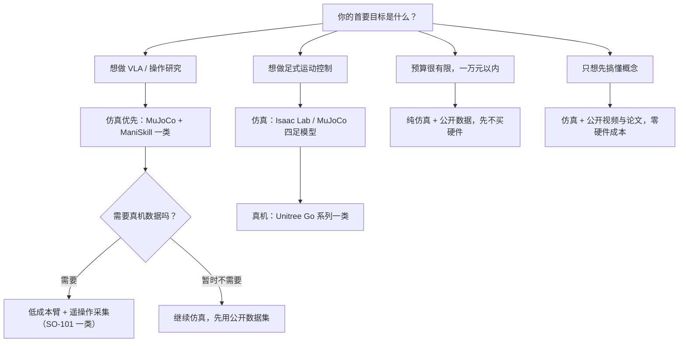

# 08 · 硬件平台面面观

> 一句话导读：算法跑在硅上，机器人活在铁里——这一篇帮你看懂一台具身智能机器人由什么组成、钱花在哪里、以及下单之前必须问清什么。

## 学习目标

- [ ] 说清执行器、传动、连杆、传感器、计算单元、电源与总线各自「决定了什么」。
- [ ] 面对桌面臂、双臂、四足、人形、移动操作五类平台，能说出各自的适用场景与难度量级。
- [ ] 在平行夹爪、灵巧手、吸盘之间做出取舍，并解释为什么 VLA 研究多数从平行夹爪起步。
- [ ] 严格区分**重复定位精度**与**绝对精度**，并读懂负载、工作半径、自由度、控制频率等指标。
- [ ] 用一张评分表和十个必问问题，完成一次有理有据的硬件选型。

## 正文

### 8.1 一台机器人由什么组成

**直觉**：机器人像一个人。执行器是肌肉，传动是肌腱，连杆是骨骼，传感器是感官，计算单元是大脑，电源与总线是血管和神经。

| 部件 | 具体是什么 | 它决定了什么 |
| --- | --- | --- |
| **执行器** | 无刷直流电机（BLDC）、舵机（servo）、直驱电机（direct drive） | 力量、速度、响应带宽。这是最贵、最影响「手感」的部分。 |
| **传动** | 谐波减速器（harmonic drive）、行星减速器、同步带、丝杠 | 扭矩放大与精度。谐波减速器体积小、回差小，是协作臂的主流；直驱没有减速器，力控透明但扭矩密度低。 |
| **连杆结构** | 铝合金、碳纤维、铸件，串联或并联 | 刚度与自重。刚度不足，算得再准也会「软」下去，绝对精度直接崩。 |
| **传感器** | 编码器（encoder）、IMU、关节力矩传感器、六维力传感器（F/T sensor）、RGB-D 相机、触觉传感器 | 机器人「知道多少」。没有力矩传感就没有真正的力控；没有相机就没有视觉闭环。 |
| **计算单元** | 工控机（IPC）、树莓派（Raspberry Pi）、嵌入式 MCU、NVIDIA Jetson 系列等边缘模块 | 能跑多大的模型、控制频率能到多少、延迟有多低。 |
| **电源与通信** | 24V/48V 供电或电池、CAN 总线、EtherCAT、串口（UART / RS-485）、以太网 | 实时性与可靠性。EtherCAT 适合多轴高同步；CAN 便宜皮实但带宽有限；串口最简单也最慢。 |
| **安全部件** | 急停按钮、硬限位开关、抱闸（brake）、安全继电器 | 出事时能不能停下来。这部分常常被新手完全忽略，却是工程上最不能省的钱。 |

一个朴素的判断法则：**预算紧的时候，先把钱花在执行器、减速器和编码器上**——它们决定了这台机器人的物理上限；相机和算力可以后加，机械精度买错了改不了。

### 8.2 常见平台分类

| 形态 | 代表产品 | 难度 | 价格量级 | 适合谁 |
| --- | --- | --- | --- | --- |
| **桌面级研究机械臂** | Franka Emika Panda / FR3、Universal Robots UR5 / UR5e、UFactory xArm、KUKA iiwa | 中 | 十万元级（xArm 一类可低至几万元级） | 高校与企业研究团队，做操作、力控、VLA |
| **低成本开源臂** | SO-100 / SO-101（Hugging Face LeRobot 社区常见） | 低 | 千元级 | 个人、学生、想低成本采数据的入门者 |
| **双臂平台** | ALOHA（低成本遥操作双臂的代表，后续有 Mobile ALOHA） | 中高 | 万元级起，按传感器配置可到十万元级 | 精细双臂操作、模仿学习、数据采集 |
| **四足** | Unitree Go 系列、Boston Dynamics Spot | 中 | 万元级（Go 系列）/ 十万元级以上（Spot） | 运动控制、巡检、野外与工业场景 |
| **人形** | Unitree G1 / H1、Figure、Tesla Optimus，以及国内智元、宇树等公司的产品 | 高 | 十万元级到更高 | 前沿研究机构、大公司、展示与长期探索 |
| **移动操作** | 底盘 + 机械臂，如 Fetch 一类研究平台 | 中高 | 十万元级 | 家庭/仓储长程任务、导航与操作结合的研究 |

几点解读，避免误读：

- **「难度」指的是「从零跑通一个有意思的实验需要多少工程投入」**，不是「这台机器多难操作」。低成本臂难度低，是因为生态简单、坏了不心疼；人形难度高，是因为平衡、全身控制、安全性全都叠在一起。
- **价格只给量级**：同一型号不同配置（夹爪、相机、力传感器、备用电池）差别很大，**以厂家官方报价为准**。二手市场、教育折扣、租赁都会显著改变数字。
- **人形不是「更高级的机械臂」**。它的价值在于形态通用（能进为人设计的环境），代价是控制难度、成本和安全风险同时上一个台阶。做操作研究，桌面臂往往比人形更高效。

### 8.3 末端执行器：机器人的「手」

| 维度 | 平行夹爪（parallel jaw gripper） | 灵巧手（dexterous hand） | 吸盘（suction） |
| --- | --- | --- | --- |
| 自由度 | 1（开合） | 十几到二十几（多指多关节） | 1（吸/放） |
| 成本 | 低 | 高（常接近或超过一条臂的价格量级） | 低 |
| 控制难度 | 低，动作空间几乎是一维 | 高，需要协调多指、处理接触 | 低，但依赖物体表面 |
| 可完成任务范围 | 抓取、放置、推、拉、简单装配 | 手内操作、精细抓握、工具使用 | 平面物体、纸箱、玻璃等光滑表面 |
| 数据采集难度 | 低，遥操作映射直观 | 高，需要手部动作捕捉或专门外骨骼 | 低 |
| 典型代表 | 各类二指电动夹爪 | Allegro Hand、Shadow Hand、LEAP Hand 一类 | 工业真空吸盘阵列 |

**为什么做 VLA 研究多数还从平行夹爪起步？** 四个很实际的理由：

1. **动作空间小且好定义**：开合一个标量 + 末端位姿，策略输出的维度低，学起来快，也好做跨本体（cross-embodiment）的数据对齐。
2. **数据可复用**：公开的大规模机器人操作数据集里，二指夹爪占了绝大多数，换手型意味着丢掉大部分可用数据。
3. **鲁棒**：不怕轻微对不准，不怕物体表面材质，坏了便宜好换。
4. **sim-to-real 差距小**：夹爪的接触模型简单，仿真里学到的抓取更容易迁移。

**快换装置（tool changer）** 值得单独提一句：它让机器人几秒内换一个末端，是「一台机器做多种任务」的工程解法。代价是增加了重量、成本和故障点，并且换工具后需要重新标定工具坐标系。

### 8.4 关键指标怎么读

#### 负载（payload）与自重比

负载是末端能稳定带起的质量（通常还要求在一定速度和加速度下不掉精度）。**自重比**（负载 / 自身重量）反映结构效率：协作臂通常在十分之一以下，人形往往更低。负载不是越大越好——更大的负载意味着更重的结构、更大的惯量、更高的安全风险。

#### 工作半径（reach）

从基座到末端能到达的最远距离。注意它和**可达工作空间**不是一回事：远处能碰到，不代表那里姿态灵活、力矩够用。实际可用范围通常比标称半径小一圈。

#### 自由度（DoF）

独立运动的数量。6 自由度能到达空间中任意位姿（位置 + 姿态）；7 自由度多一个冗余，能绕开奇异点和障碍，但逆运动学更难。夹爪的开合通常单独计数，所以会看到「6 + 1」这样的写法。

#### 重复定位精度 vs 绝对精度（重点）

这两件事经常被混为一谈，但它们完全不同：

- **重复定位精度（repeatability）**：机器人**多次回到同一个指令位置**时，实际落点之间的离散程度。它衡量的是「稳定性」。
- **绝对精度（accuracy）**：机器人**到达指定坐标**时，实际位置与指令位置的偏差。它衡量的是「准不准」。

**类比**：射箭时，箭全扎在靶子左下方一小块区域——重复性极好，但绝对精度很差（因为瞄准系统有系统偏差）。反过来，箭散布得满靶都是但平均落在靶心——绝对精度好，重复性差。

**为什么工业规格书几乎只标重复定位精度？** 因为传统工业机器人靠「示教—复现」工作：人把机器人拖到位置，记下来，之后反复回这个点。系统偏差在示教时被「吸收」了，只要每次都回到同一点就够了。而**研究场景（尤其是 VLA）恰好相反**：策略输出的是坐标或位姿指令，要求机器人真的到那里——所以绝对精度、标定质量、视觉闭环，对你的任务更关键。看到规格书只写 «±0.02 mm» 时，要意识到那是重复性，不是绝对精度。

#### 控制频率、延迟、力控、安全等级

- **控制频率**：每秒下发多少次指令。关节伺服环通常在千赫兹量级，而策略推理可能只有几赫兹到几十赫兹。**两者不是一回事**，中间需要一个「高层慢、底层快」的分层结构。
- **通信延迟**：从发出指令到关节动起来的滞后。延迟大，力控和高动态任务基本没戏。
- **力控能力**：有没有力矩接口、有没有力矩传感、能不能做阻抗/导纳控制。想做插拔、擦拭、柔性装配，这一项是硬门槛。
- **安全等级**：是否满足协作机器人相关标准、有没有安全-rated 的输入输出。这一项决定它能不能和人共享工作空间。

### 8.5 安全隐患与工程规范

机械臂是一个**几公斤到几十公斤、以米每秒量级速度运动的刚性物体**。它的杀伤力和一个挥动的铁棍同级。以下是最基本的一组工程规范：

- **急停（E-stop）**：物理按钮，直接切断动力，必须独立于软件、随时可达。急停之后要有明确的复位流程，不能一按就自动恢复。
- **软限位与硬限位**：软件限制关节角范围（软限位），硬件限位开关或机械挡块作为最后一道防线（硬限位）。**两层都要有**。
- **力矩上限与速度限制**：即使指令是「全速冲过去」，驱动层也要有独立的限幅。这是防止策略输出异常值造成事故的第一道闸。
- **碰撞检测**：通过电流突变或外部力矩估计判断「撞到东西了」，触发停止或回退。用力矩传感的机器人通常自带这个能力。
- **人机共处的安全概念**：协作机器人（cobot）的安全思路包括功率与力限制（power and force limiting）、速度与分离监控（speed and separation monitoring）等，业界常引用 **ISO 10218**（工业机器人安全）与 **ISO/TS 15066**（协作机器人补充要求）这类标准。**具体条款以标准原文为准**，实际落地还需要风险评估和第三方认证。
- **模型输出必须经过安全层**：这是具身智能时代最重要的一条工程原则。神经网络的输出是不可信输入，必须经过一层确定性代码：动作限幅（clip）、速度/加速度限制、工作空间包围盒检查、看门狗超时归零、奇异点保护。**永远不要把一个学习策略的输出直接接到电机上。**

### 8.6 成本与选型决策指南

#### 决策树

核心判断只有一句：**先仿真，再真机；先单一任务，再通用能力**。绝大多数「一上手就买设备」的项目，最后设备都在吃灰。

#### 选型评分表模板

给每个候选平台打 1~5 分，乘以权重后求和。权重按你的任务改，**权重之和必须为 1**。

| 维度 | 权重 | 候选 A | 候选 B | 说明 |
| --- | --- | --- | --- | --- |
| 自由度与工作空间 | 0.15 | | | 能否覆盖目标任务的空间范围 |
| 负载 | 0.10 | | | 要抓的最重物体 + 余量 |
| 精度（重复 + 绝对） | 0.15 | | | 研究场景别只看重复精度 |
| 力控与柔顺能力 | 0.15 | | | 有无力矩接口，能否做阻抗控制 |
| 开源生态与 SDK | 0.15 | | | 有无官方 URDF、Python SDK、仿真模型 |
| 社区与教程 | 0.10 | | | 遇到问题有没有人踩过 |
| 成本（含配件与维护） | 0.10 | | | 别只算本体价格 |
| 安全性 | 0.05 | | | 急停、限位、协作认证 |
| 可维护性 | 0.05 | | | 备件、维修周期、是否要返厂 |
| **加权总分** | **1.00** | | | |

#### 下单前必须确认的 10 个问题

1. SDK 是否官方支持 Python？有没有可运行的示例代码？
2. 是否提供**力矩/电流级**的控制接口，还是只能发位置指令？
3. 官方是否提供 URDF（以及 MuJoCo / Isaac 的仿真模型）？
4. 控制环频率是多少？对外接口的最大指令频率是多少？
5. 是否内置碰撞检测与力矩限幅？能否由用户配置？
6. 急停、使能、安全 I/O 的接线与语义是否文档化？
7. 备件（电机、减速器、线缆）能否单独购买？维修周期多久？是否需要返厂？
8. 是否需要额外的安全认证或培训才能合法使用？保险怎么算？
9. 夹爪、相机、力传感器的安装接口是否标准化（法兰规格、供电、通信）？
10. 有没有同型号的真实用户社区？能不能找到别人踩坑的记录？

## 动手练习

### 练习一：用公开规格书填完一张选型表

任选三个真实在售的平台（建议组合：一个十万元级研究臂、一个低成本开源臂、一个四足），从**官方规格书与官方文档**里查数据，填完 8.6 的评分表，然后写一段 **200 字以内的结论**。

要求：
- 每一格分数后面用括号注明依据（如「5（官方 URDF 与 Python SDK 均有）」）。
- 结论必须回答：**在你的任务下，多花的钱买到了什么？值不值？**
- 凡是查不到的指标，写「官方未标注」，**不要猜**。

### 练习二：读懂规格书

下面是一段**完全虚构的示例数据**，仅用于练习读表，不代表任何真实产品：

| 项目 | 数值（虚构示例数据） |
| --- | --- |
| 自由度 | 6 + 1（夹爪） |
| 负载 | 3 kg |
| 自重 | 18 kg |
| 工作半径 | 600 mm |
| 重复定位精度 | ±0.05 mm |
| 绝对精度 | 未标注 |
| 关节最大速度 | 180 °/s |
| 力控 | 关节力矩传感，控制环 1 kHz |
| 通信 | EtherCAT |
| 防护等级 | IP54 |
| 价格量级 | 十万元级 |

请回答三个问题：

1. 它**适合**什么任务？给出两条理由。
2. 它**不适合**什么任务？给出两条理由。
3. 「绝对精度未标注」这件事，对你的研究意味着什么？你会怎么补上这个信息？

**参考答案要点**：适合中等负载的桌面级操作、需要力控的插拔/装配/擦拭类任务（有 1 kHz 力矩控制）、需要在粉尘环境工作的场景（IP54）。不适合重载搬运（3 kg 负载偏小）、不适合大范围作业（600 mm 半径有限）、不适合需要高绝对精度的免标定任务。绝对精度未标注意味着厂商默认你走「示教—复现」流程；补法是自己做手眼标定 + 外部测量（如激光跟踪仪或标定板）实测，或用视觉闭环把绝对误差吸收掉。

## 常见误区

1. **新手常以为「自由度越多越强」，其实是任务决定自由度。** 桌面抓取放 6 自由度足够，多出来的自由度带来的是逆解难度、成本和标定负担。
2. **新手常以为「±0.02 mm 说明特别准」，其实那通常只是重复定位精度。** 它只保证「每次都回到同一点」，不保证「第一次就到对的地方」。
3. **新手常以为「负载越大越划算」，其实是自重比和惯量才是真问题。** 重负载机械臂自重更大、更危险、控制更难，小任务上反而是负担。
4. **新手常以为「买了机械臂就能做 VLA」，其实还要夹爪、相机、标定、遥操作、数据管线和安全层。** 本体往往只占总投入的一部分。
5. **新手常以为「人形是终点形态」，其实是形态要匹配任务与环境。** 操作研究用桌面臂效率更高，人形的价值要在「为人类设计的环境」里才体现。

## 延伸阅读

- Franka Research 3 官方页面（研究级协作臂的规格与接口文档）：https://franka.de/
- Universal Robots 官方文档（UR 系列规格与编程接口）：https://www.universal-robots.com/
- Unitree 官方站点（Go 系列与四足/人形产品资料）：https://www.unitree.com/
- Boston Dynamics Spot 官方页面：https://bostondynamics.com/
- ALOHA 项目主页（低成本双臂遥操作，论文 *Learning Fine-Grained Bimanual Manipulation with Low-Cost Hardware*）：https://tonyzhaozh.github.io/aloha/
- Hugging Face LeRobot 仓库（含 SO-100 / SO-101 等低成本硬件与数据格式）：https://github.com/huggingface/lerobot
- ISO 官方站点（检索 ISO 10218 与 ISO/TS 15066 的目录与摘要，全文需购买）：https://www.iso.org/
- 书籍：Bruno Siciliano 等, *Robotics: Modelling, Planning and Control*, Springer（运动学、动力学、控制的标准教材）。
- 书籍：Kevin Lynch, Frank Park, *Modern Robotics: Mechanics, Planning, and Control*, Cambridge University Press（有官方免费电子版）。

## 自测题

**1. 用射箭的类比解释「重复定位精度」和「绝对精度」的区别，并说明为什么工业规格书常只标前者。**

点击查看答案

重复定位精度像「箭都扎在同一个位置」，哪怕整体偏左下——稳定但可能不准；绝对精度像「箭的平均落点是否在靶心」——准不准。工业机器人传统上用「示教—复现」工作：人手动把机器人带到目标点并记录，系统偏差在示教时就被吸收了，之后只需要每次都回到同一点。所以厂商优先标重复精度。而策略输出坐标的研究场景要求「说到哪就到哪」，绝对精度和标定质量更关键。

**2. 做 VLA 操作研究，为什么大多数人从平行夹爪而不是灵巧手起步？给出三条理由。**

点击查看答案

(1) 动作空间小（开合 + 位姿），策略容易学，也便于跨本体数据对齐；(2) 公开的大规模操作数据集绝大多数是二指夹爪，换手型会丢掉大部分可用数据；(3) 鲁棒、便宜、好维护，接触模型简单使 sim-to-real 差距更小。灵巧手的优势在精细手内操作，但那类数据和遥操作方案都还更贵更难。

**3. 一条 6 自由度机械臂标称负载 3 kg、工作半径 600 mm，这组数字在哪两种任务上会立刻不够用？**

点击查看答案

(1) 需要搬运重物或使用较重末端（如大功率吸盘、双臂协同搬运）的任务——3 kg 要扣掉夹爪重量和动态余量；(2) 需要在大范围空间作业的任务，如整张桌面到高货架、或移动底盘之外的远距离取放——600 mm 半径扣除机身占位后实际可用范围更小。另外，远处末端力矩余量下降，「能碰到」不等于「能干活」。

**4. 什么是「模型输出必须经过安全层」？请列出至少四项安全层应该做的事。**

点击查看答案

含义：神经网络的输出是不可信输入，绝不能直接下发给电机，必须经过确定性代码过滤。安全层应做的事包括：动作限幅（clip 到关节范围与力矩上限）、速度/加速度限制、工作空间包围盒检查、看门狗超时归零（通信断了就停）、奇异点保护、碰撞检测触发回退、以及独立的硬件急停与硬限位。

**5. 有人建议你「直接买一台人形做操作研究」，请给出两条支持理由和两条反对理由。**

点击查看答案

支持：形态通用，能进入为人设计的环境（门、楼梯、工具），长期看数据与任务更贴近真实世界；平台关注度高，便于展示与招募。反对：成本与安全风险高，平衡与全身控制难度大，会把大量工程精力消耗在与操作研究无关的问题上；同等预算下用桌面臂 + 夹爪能做更多次实验、采更多数据，科研产出效率更高。

