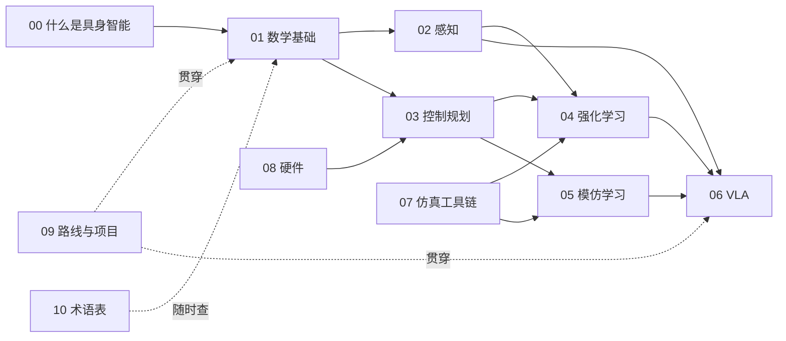

# docs/ 索引：按「你想问什么」找文章

正文共 11 篇，建议顺序见 [根目录 README](../README.md#内容导航-按建议阅读顺序)。
这里提供两种**非顺序**的找法。

---

## 一、按问题找

| 我心里在想… | 去看 |
|---|---|
| 具身智能到底和 ChatGPT 有什么区别？ | [00-什么是具身智能](./00-什么是具身智能.md) |
| 为什么"走路"比"下棋"难？ | [00-什么是具身智能](./00-什么是具身智能.md) 的莫拉维克悖论 |
| 机器人怎么表示自己"在哪、朝哪"？ | [01-机器人学数学基础](./01-机器人学数学基础.md) 的「位姿」 |
| 旋转矩阵 / 四元数 / 欧拉角该用哪个？ | [01-机器人学数学基础](./01-机器人学数学基础.md) 的「旋转的三种表示」 |
| 齐次变换为什么有时左乘有时右乘？ | [01-机器人学数学基础](./01-机器人学数学基础.md) 的「复合变换」 |
| 逆运动学为什么会有多个解？ | [01-机器人学数学基础](./01-机器人学数学基础.md) 的「IK」 |
| 雅可比矩阵是干嘛的？ | [01-机器人学数学基础](./01-机器人学数学基础.md) 的「雅可比」 |
| 相机拍到的像素怎么变成三维点？ | [02-感知与传感器](./02-感知与传感器.md) 的「针孔模型」 |
| 手眼标定到底在校准什么？ | [02-感知与传感器](./02-感知与传感器.md) 的「标定」 |
| 单目相机为什么没有绝对尺度？ | [02-感知与传感器](./02-感知与传感器.md) 的「相机模型」 |
| 机器人知道自己在哪是靠什么？ | [02-感知与传感器](./02-感知与传感器.md) 的「SLAM 与状态估计」 |
| PID 三个字母分别管什么？ | [03-运动规划与控制](./03-运动规划与控制.md) 的「控制基础」 |
| 为什么擦桌子需要"柔顺控制"？ | [03-运动规划与控制](./03-运动规划与控制.md) 的「阻抗控制」 |
| RRT 为什么能绕开障碍物？ | [03-运动规划与控制](./03-运动规划与控制.md) 的「运动规划」 |
| 配置空间（C-space）是什么？ | [03-运动规划与控制](./03-运动规划与控制.md) 的「配置空间」 |
| 强化学习的奖励函数该怎么设计？ | [04-强化学习与机器人](./04-强化学习与机器人.md) 的「奖励设计」 |
| 为什么机器人领域默认用 PPO？ | [04-强化学习与机器人](./04-强化学习与机器人.md) 的「算法地图」 |
| 仿真里学会的为什么到真机就崩？ | [04-强化学习与机器人](./04-强化学习与机器人.md) 的「sim2real」 |
| 示教数据从哪来？ | [05-模仿学习与示教](./05-模仿学习与示教.md) 的「示教数据」 |
| 行为克隆为什么会越走越偏？ | [05-模仿学习与示教](./05-模仿学习与示教.md) 的「分布偏移」 |
| 动作分块（action chunking）解决什么问题？ | [05-模仿学习与示教](./05-模仿学习与示教.md) |
| 扩散策略为什么适合机器人？ | [05-模仿学习与示教](./05-模仿学习与示教.md) 的「扩散策略」 |
| VLA 和"用 GPT 指挥机器人"有什么不同？ | [06-VLA视觉语言动作模型](./06-VLA视觉语言动作模型.md) 的「三种范式」 |
| 动作怎么被模型输出？token 还是回归？ | [06-VLA视觉语言动作模型](./06-VLA视觉语言动作模型.md) 的「动作表示」 |
| RT-2 / OpenVLA / Octo / π0 各是什么定位？ | [06-VLA视觉语言动作模型](./06-VLA视觉语言动作模型.md) 的「里程碑工作」 |
| 论文里的成功率为什么我复现不出来？ | [06-VLA视觉语言动作模型](./06-VLA视觉语言动作模型.md) 的「评测与现实差距」 |
| 我该装哪个仿真器？ | [07-仿真环境与工具链](./07-仿真环境与工具链.md) 的「物理引擎对比」 |
| URDF 和 MJCF 有什么区别？ | [07-仿真环境与工具链](./07-仿真环境与工具链.md) 的「机器人描述格式」 |
| ROS 是必须学的吗？ | [07-仿真环境与工具链](./07-仿真环境与工具链.md) 的「ROS / ROS 2 入门」 |
| 做具身智能需要什么显卡/环境？ | [07-仿真环境与工具链](./07-仿真环境与工具链.md) 的「环境搭建指引」 |
| 第一台机械臂该买什么？ | [08-硬件平台面面观](./08-硬件平台面面观.md) 的「成本与选型建议」 |
| 负载/重复精度/工作半径怎么读？ | [08-硬件平台面面观](./08-硬件平台面面观.md) 的「关键硬件指标」 |
| 夹爪和灵巧手怎么选？ | [08-硬件平台面面观](./08-硬件平台面面观.md) 的「末端执行器」 |
| 我该按什么顺序学、多久？ | [09-学习路线与实践项目](./09-学习路线与实践项目.md) |
| 有没有能马上做的练手项目？ | [09-学习路线与实践项目](./09-学习路线与实践项目.md) 与 [projects/](../projects/README.md) |
| 这个英文缩写是什么意思？ | [10-术语表](./10-术语表.md) |

---

## 二、按主题与前置关系

| 文档 | 前置 | 难度 | 建议投入 |
|------|------|------|---------|
| [00](./00-什么是具身智能.md) | 无 | ⭐ | 1~2 小时（读懂即可） |
| [01](./01-机器人学数学基础.md) | 线性代数 | ⭐⭐⭐ | 1~2 周（**硬前置，务必动手算**） |
| [02](./02-感知与传感器.md) | 01 的位姿部分 | ⭐⭐ | 3~5 天 |
| [03](./03-运动规划与控制.md) | 01 | ⭐⭐⭐ | 1~2 周 |
| [04](./04-强化学习与机器人.md) | 概率、一点 DL | ⭐⭐⭐ | 2 周 + 大量调参时间 |
| [05](./05-模仿学习与示教.md) | 04 可选、DL 必备 | ⭐⭐⭐ | 1~2 周 |
| [06](./06-VLA视觉语言动作模型.md) | 05 + 02 | ⭐⭐⭐ | 2~4 周（含读论文） |
| [07](./07-仿真环境与工具链.md) | Python | ⭐⭐ | 2~3 天（会被环境坑占掉一半） |
| [08](./08-硬件平台面面观.md) | 无 | ⭐ | 半天（买之前再看一遍） |
| [09](./09-学习路线与实践项目.md) | 无 | ⭐ | 先读，然后每阶段回看 |
| [10](./10-术语表.md) | 无 | ⭐ | 当字典查，不要背 |

---

## 三、怎么用这些文档

1. **每篇开头有「学习目标」**：读完对照勾选，勾不上就说明该回头看哪节。
2. **每篇有「动手练习」**：跳过练习等于没读。具身智能是工程学科。
3. **每篇有「常见误区」**：这些是我（和你）真踩过的坑，先看一眼能省几小时。
4. **每篇有「自测题」**：折起来先自答，再点开对答案。
5. 具体的**项目**放 [projects/](../projects/README.md)，**论文**放 [papers/](../papers/README.md)，**我自己的笔记**放 [notes/](../notes/README.md)。

> 发现错误或更好的讲法：直接改，并在提交信息里写清 `docs(01-math): 修正雅可比维度描述`。
