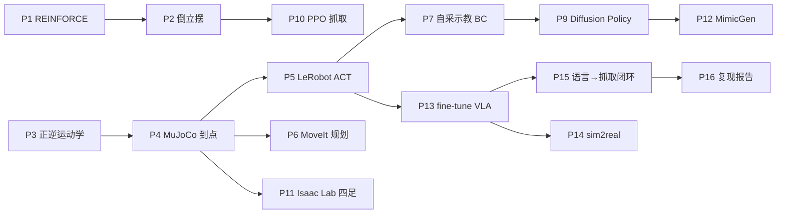

# projects/ —— 练手项目的落地目录

> [docs/09-学习路线与实践项目](../docs/09-学习路线与实践项目.md) 里是**项目菜谱**（做什么、验收标准、工作量）；
> 这里管的是**真正动手时的目录组织**（代码放哪、结果怎么记、怎么不让一个项目烂尾）。

理论读得再多，没有能跑的东西就等于没学。这个目录的唯一目的：**保证你每周都有一个可运行、可截图、可复述的产物。**

---

## 一、项目编号与 docs/09 对齐

docs/09 已给出 16 个项目（P1～P16）。**不在这里重抄一遍**，避免两处内容打架。做项目时按下面的目录约定建文件夹，编号沿用 P 编号：

| 编号 | 项目 | 难度 | 建议先读 |
|------|------|------|---------|
| P00 | [MuJoCo 仿真在 meshcat 中可视化](./P00-mujoco-meshcat-visualization/README.md) | ⭐ | [07 仿真工具链](../docs/07-仿真环境与工具链.md) |
| P1 | 手写 REINFORCE 让小车立稳 | ⭐ | [04 强化学习](../docs/04-强化学习与机器人.md) |
| P2 | PyBullet 训练倒立摆 | ⭐⭐ | [04](../docs/04-强化学习与机器人.md)、[07 仿真工具链](../docs/07-仿真环境与工具链.md) |
| P3 | 用 pinocchio 算正逆运动学 | ⭐⭐ | [01 数学基础](../docs/01-机器人学数学基础.md) |
| P4 | MuJoCo 里让机械臂到达目标点 | ⭐⭐ | [01](../docs/01-机器人学数学基础.md)、[07](../docs/07-仿真环境与工具链.md) |
| P5 | 跑通 LeRobot 的 ACT 训练 demo | ⭐⭐⭐ | [05 模仿学习](../docs/05-模仿学习与示教.md) |
| P6 | 用 MoveIt 做避障规划 | ⭐⭐⭐ | [03 控制规划](../docs/03-运动规划与控制.md) |
| P7 | 自采一小份示教数据训练行为克隆 | ⭐⭐⭐ | [05](../docs/05-模仿学习与示教.md) |
| P8 | 手眼标定 + 视觉抓取 | ⭐⭐⭐ | [02 感知](../docs/02-感知与传感器.md) |
| P9 | 复现 Diffusion Policy 的推到任务 | ⭐⭐⭐⭐ | [05](../docs/05-模仿学习与示教.md) |
| P10 | 自己实现 PPO 训练机械臂抓取 | ⭐⭐⭐⭐ | [04](../docs/04-强化学习与机器人.md) |
| P11 | Isaac Lab 里训练四足行走 | ⭐⭐⭐⭐ | [04](../docs/04-强化学习与机器人.md)、[07](../docs/07-仿真环境与工具链.md) |
| P12 | 用 MimicGen 合成数据并做对比 | ⭐⭐⭐⭐ | [05](../docs/05-模仿学习与示教.md) |
| P13 | 仿真 fine-tune 一个 VLA 模型 | ⭐⭐⭐⭐⭐ | [06 VLA](../docs/06-VLA视觉语言动作模型.md) |
| P14 | sim2real 迁移 | ⭐⭐⭐⭐⭐ | [04](../docs/04-强化学习与机器人.md)、[08 硬件](../docs/08-硬件平台面面观.md) |
| P15 | 搭一个"语言指令 → 抓取"完整闭环 | ⭐⭐⭐⭐⭐ | [06](../docs/06-VLA视觉语言动作模型.md) |
| P16 | 写一篇论文复现报告 | ⭐⭐⭐⭐ | [papers/](../papers/README.md) |

完整描述（任务、前置、验收标准、预计工作量、常见坑）以 [docs/09](../docs/09-学习路线与实践项目.md) 为准。

### 如果只能做一个：**先做 P4**

理由：它同时练到"装环境（会踩坑）+ 位姿变换（真的会用）+ 仿真循环（看懂 env.step）"三件事，耗时最短（一个周末量级），而且是后面 P5–P15 的地基。
预算再紧就退一步做 P3 —— 纯 numpy/pinocchio，不用装渲染，当天就能看到正逆运动学的数字。

---

## 二、目录约定

一个项目一个文件夹，编号沿用 docs/09 的 P 编号：

```
projects/
└── P04-mujoco-reach-target/
    ├── README.md        # 项目卡：目标、前置、步骤、验收、结论（从模板复制）
    ├── env/             # 环境说明或 environment.yml / requirements.txt（不要提交虚拟环境本体）
    ├── src/             # 代码
    ├── configs/         # 超参数/场景配置（yaml）
    ├── results/         # 结果：图表、指标 csv（大文件不进 git，见 .gitignore）
    └── notes.md         # 踩坑记录：报错原文 + 怎么解决的（最有价值的部分）
```

命名规则：`P<两位编号>-<小写英文短名>/`，**不要中文、不要空格**（跨平台与命令行最省事）。

### ⚠️ 不要提交的东西

模型权重、数据集、视频、`__pycache__`、虚拟环境目录都已写进根目录 [.gitignore](../.gitignore)。真要放权重/数据，写进项目卡 README 的"如何获取"一节，给下载脚本或外链。

---

## 三、项目卡模板

每个项目开工前，从下面复制到 `projects/Pxx-xxx/README.md`，先填空再写代码（先想清楚验收标准，能省掉一半返工）：

```markdown
# P04 · MuJoCo 里让机械臂到达目标点

- 状态：进行中 / 完成 / 放弃（写明为什么放弃）
- 起止：2026-11-24 ~ 2026-11-26，实际投入约 6 小时
- 关联章节：../../docs/01-机器人学数学基础.md（位姿、IK）、../../docs/07-仿真环境与工具链.md

## 目标
让 7 自由度机械臂末端在 100 步内到达随机目标点，位置误差 < 1 cm。

## 前置
- 环境：conda 环境 xxx，mujoco 版本 xxx
- 已完成的章节 / 项目：P3

## 步骤
1. ...
2. ...

## 验收标准（可量化）
- [ ] 10 次随机目标，成功 ≥ 9 次
- [ ] 平均收敛步数 < 60
- [ ] 能解释每步里 `mj_step` 之后发生了什么

## 结果
（放图：，贴指标表格）

## 结论与反思
- 学到什么：
- 卡在哪、怎么解决的：
- 如果重做一次，会怎么改：
```

> 图片请存到仓库根目录的 [assets/images/](../assets/images/)（命名用小写英文连字符），不要塞进 `projects/` 内部，方便被文档复用。

---

## 四、让项目不烂尾的四条纪律

1. **先写验收标准，再写代码。** 没有验收标准的项目 90% 会变成"看了一天教程"。
2. **每个项目不超过 3 天。** 超过就砍范围：先跑通"能到点"，再谈"抓得稳"。
3. **第一天就要跑通最小闭环**：环境能装好 → 场景能渲染 → 脚本能跑完一次，哪怕全是随机的。**能跑 > 跑得好。**
4. **踩坑必记 `notes.md`**：报错原文 + 解决方式。同一个坑你会踩第二次，而网上搜到的答案往往不对应你的版本。

---

## 五、项目之间的关系（建议顺序）



两条主线：**"会动"线（P3→P4→P6/P11）** 练机器人与控制；**"会学"线（P1→P2→P10 或 P5→P7→P9→P13）** 练学习算法。两条线在 P14/P15 汇合。别同时开两条线，会都做不完。
